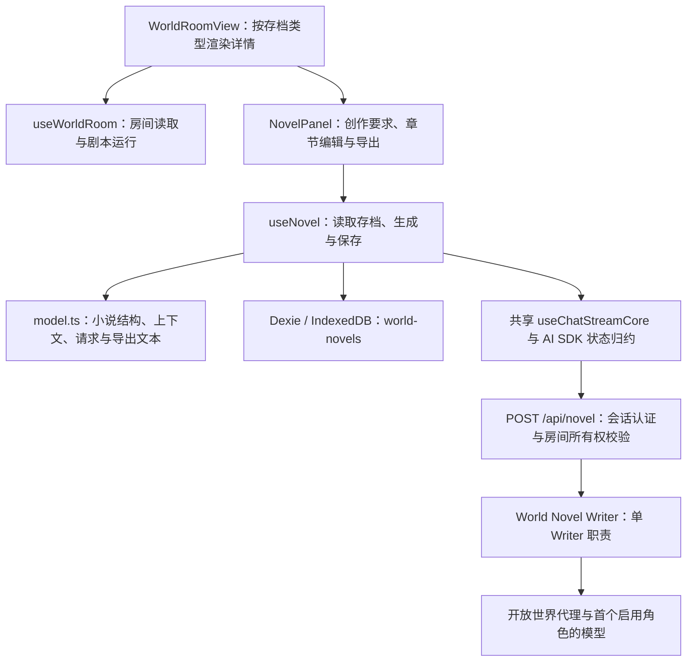
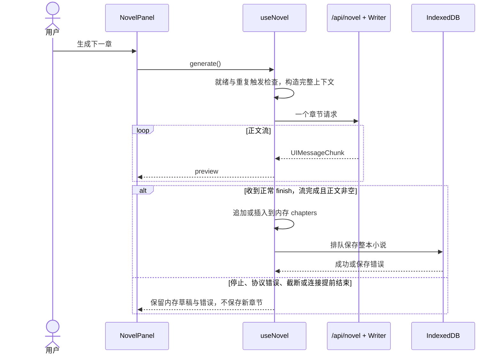

# 开放世界小说模式架构

状态：2026-11-18。第 1～7 节描述已有实现及其边界，第 8～10 节为演进设计和验收要求。

## 1. 核心决策

小说模式由**一个写作智能体**统一负责情节、人物言行、叙事视角、文风和章节衔接。角色是作者掌握的创作资料，不是需要分别调用的 Agent。规划、写作、修改和剧情整理即使以后拆成多个任务，也由同一个 Writer 承担，不新增导演、角色、旁白或摘要智能体。

剧本和小说复用开放世界首页的通用模板、设定编辑器与角色资料。用户使用模板时选择作品类型，创建后可在同一个作品列表中通过卡片标签区分，详情里不能切换。两类房间都可在世界设定中粘贴前置剧情或导入 TXT、Markdown；小说背景总结文件在此处仅取可读总结正文。

### 模式边界

| 项目 | 世界群聊 | 小说模式 |
|---|---|---|
| 产物 | 按顺序发生的角色对白与旁白消息 | 按章节排列的连续小说正文 |
| 生成职责 | 调度角色或旁白，必要时整理公共历史 | 一个 Writer 掌握全局，统一创作 |
| 人物私有资料 | 按角色隔离，其他角色不应获知 | 作者能看到全部，按剧情安排揭示 |
| 用户输入 | 系统干预、角色对白或旁白 | 创作要求、大纲、视角、下一章要求与正文修改 |
| 推进方式 | 页面订阅可自动接续多批对白 | 用户每次触发一章，不自动连写 |
| 正文存档 | 服务端世界房间存档 | 当前浏览器 IndexedDB |
| 生成接口 | `/api/group-chat/rooms/:id/runs` | `/api/novel` |
| 运行对象 | `WorldRun` | 当前仅为前端生成状态，没有小说运行实体 |

## 2. 模块与依赖



代码入口：

- [`world-room/index.tsx`](../src/app/agent/worlds/_components/world-room/index.tsx)：按房间类型呈现剧本或小说界面，复用世界设定面板。
- [`use-world-room.ts`](../src/app/agent/worlds/_components/use-world-room.ts)：读取、轮询房间，只为剧本自动开始对话。
- [`novel/novel-panel.tsx`](../src/app/agent/worlds/_components/novel/novel-panel.tsx)：输入创作要求，选择与编辑章节，展示流式草稿，触发 TXT / Markdown 下载。
- [`novel/use-novel.ts`](../src/app/agent/worlds/_components/novel/use-novel.ts)：协调本机存档、生成请求、流事件、完成判定和写入队列。
- [`novel/model.ts`](../src/app/agent/worlds/_components/novel/model.ts)：`Novel` / `Chapter`、默认值、Writer 指令、上下文构造、请求参数和导出文本。
- [`/api/novel`](../src/app/api/novel/route.ts)、[`novel.ts`](../src/lib/group-chat/novel.ts) 与 [`world-agents.ts`](../mastra-server/agents/world-agents.ts)：校验会话、来源和房间所有权，由同一世界 Agent 工厂创建的 Writer 负责生成。

页面层依赖现有原子组件、字段组件与 `UnifiedMarkdown`；流生命周期、取消和文本归约复用 `@landing-page/utils/stream`。不为小说重复实现 SSE 解析器，也不接入群聊的选人、旁白轮次和连续批次逻辑。

## 3. 数据模型与数据归属

### 当前小说结构

```ts
type Chapter = {
  id: string;
  title: string;
  text: string;
};

type Novel = {
  title: string;
  style: string;
  outline: string;
  chapterGoal: string;
  words: string;
  chapters: Chapter[];
  background?: ImportedNovelBackground; // 普通剧情文本或带来源信息的背景总结
};
```

`chapters` 数组顺序就是章节顺序。默认标题为“第 N 章”，可以手工编辑。`words` 是表单字符串，生成请求时转换为数字；当前界面允许目标字数 500～4000，默认 2000，属于模型创作目标，不保证输出精确字数。

小说首次打开时以世界名称初始化书名、以 `storyGoal` 初始化大纲，给出默认第三人称文风。此后小说书名和大纲独立保存，不随世界字段自动覆盖；每次生成仍读取当前 `room.config`，因此世界设定修改影响后续生成，但不重写已有章节。

| 数据 | 当前权威来源 | 生命周期与用途 |
|---|---|---|
| 世界背景、规则、事实、人物 | 服务端 `WorldRoom.config` | 小说生成时读取；原有配置快照仍归世界模块 |
| 小说设定与已完成章节 | IndexedDB `world-novels` 的 `novels` 表 | 主键 `${ownerId}:${roomId}`，以整本小说对象读写 |
| 房间类型 | 服务端 `WorldRoom.kind` | 创建与导入时必填，创建后固定 |
| 生成中的正文与失败片段 | `useNovel` 内存状态 `preview` | 不加入已完成章节；刷新或卸载后不恢复 |
| 导入的小说背景 | `Novel.background`，随小说存入 IndexedDB | 普通剧情文本，或包含原世界设定和来源的背景总结；不覆盖本书设定与成稿 |
| 模型请求与响应 | `/api/novel` / 世界代理链路 | 不是小说业务存档，也不用于恢复本机章节 |

本机存储按用户和房间区分记录，不等于设备上的加密隔离。清除浏览器数据、换浏览器或换设备后不能依靠世界房间恢复小说。当前删除房间、复制世界和导入世界备份都没有处理小说 IndexedDB 数据：旧记录不会自动清理，复制出来的新房间也不会携带章节。

## 4. Writer 上下文与调用契约

### 上下文构成

`chapterPrompt` 把以下资料作为一个 JSON 文本用户消息传给 Writer：

1. `world`：当前完整世界设定，包含所有人物、个人目标和私有资料。
2. `novel`：小说书名、文风和大纲。
3. `completedChapters`：按顺序传入所有已完成章节的最新标题与正文。
4. `task`：下一章节序号、目标字数、本章要求；未填写本章要求时按大纲继续。
5. `importedBackground`：用户从本地导入的剧情文本或带原世界设定的背景总结；没有导入时省略。它不计入本书章节数量。

Writer 指令要求仅输出本章正文，不输出分析、额外章标题、群聊格式或下一章。角色 `enabled` 原本表示群聊发言资格，当前上下文不会据此过滤人物。模型由服务端读取房间配置，采用第一个启用角色的 `model`；全部禁用时取第一个角色。世界 `narration` 和 `maxTurns` 不驱动小说调度。

群聊消息、公共历史摘要和未完成小说片段不进入小说上下文。小说从世界设定的初始场景和自身正文发展；当前没有“从群聊剧情接续写小说”的显式导入流程。

### 当前请求

```ts
{
  roomId,
  prompt: "完整创作上下文 JSON 文本",
  task: "chapter" // 或 "summary"、"rewrite"
}
```

`POST /api/novel` 从登录会话取得所有者，校验同源请求与房间所有权，限制上下文不超过 150,000 字符。服务端固定 Writer / Summary 指令、禁用工具、限制单步和 8192 输出 token，不接受客户端覆盖模型、指令或工具配置。

Writer 由世界 Agent 工厂创建，使用相同的 `GROUP_CHAT_BASE_URL` / `GROUP_CHAT_API_KEY`，默认代理为 `http://127.0.0.1:3425/v1`。模型取房间中第一个启用角色的配置，全部禁用时取第一个角色。写章和背景总结共用此模型，暂未提供小说独立模型选择。

代理会话使用 `worldSessionId(room, "writer", model)`，隔离所有者、房间、配置、模型和群聊角色。Writer 不配置自动 Memory，不混入普通聊天线程；请求与响应仍经过服务端、代理和既有观测链路，不能描述为纯本机处理。单智能体指一次任务由一个 Writer 执行，不代表每本书创建独立的 Agent 实例。

## 5. 创建与生成生命周期

### 房间类型

剧本创建后可自动开始对话；小说由作者手动生成章节。服务端只允许剧本发起多人对话、小说生成章节。缺少类型的房间和备份格式不受支持。

### 一章生成

在章节目录选中已有章节后，可以点击「在本章前插入」，填写独立的创作要求。请求仍使用 `chapter` 任务，在提示词中通过 `task.mode: "insert"` 区分，带上目标章之前的 `previousChapters` 和从目标章开始的 `followingChapters`。Writer 负责衔接两侧内容；全书超限时只保留紧邻插入点的完整章节，仍超限则不请求。

普通续写保存到书末；补写完整结束才按已有章节 ID 插入，界面切换到新章。形如「第5章」的默认章名按新位置编号；自定义标题、原有章节 ID 和正文保留。停止或失败时不改变章节顺序。



当前 `finish` 事件有 `finishReason` 时要求为 `stop`；缺失原因的 `finish` 也会被接受。还必须等流正常结束并检查正文非空，才追加章节。没有 `finish` 的连接结束，以及 `length` 等非正常完成原因，都不能成为已完成章节。

`generating` ref 防止同一 Hook 重复提交，`useChatStreamCore` 管理取消与卸载清理。停止会取消浏览器订阅，不自动重试，不续写草稿；再次生成仍写同一个章节序号。服务端将 `request.signal` 传给 Writer，浏览器取消可沿流式链路传播；上游是否立即停止计算或计费取决于代理与模型服务。

完成后先更新前端章节数组，再异步保存。保存失败时本章仍可在当前页面查看、导出，也可能被下次生成用作上下文；它尚不是持久化成功的章节。当前没有“仅重试保存”操作，后续一次完整对象写入可以重新保存当前内容。

## 6. 编辑、上下文预算与导出

章节编辑直接修改当前小说对象，更新后进入本机写入队列，下一章使用修改后的全文。当前没有修订历史、章节锁、依赖失效标记或自动重写后续章节；修改早期事件后，已有后续章节可能与之冲突，需要作者手工处理。

「润色重写」由同一个 Writer 处理。提示词区分目标章原文、前文和固定的后文，要求承接前一章结尾、保留后一章依赖的事实与伏笔，并让新的结尾自然过渡到后一章。全书超过请求上限时，仅保留目标章和完整的相邻章；仍超限则不生成。完成的草稿留在当前页面，用户采用后只替换目标章正文，标题、ID、顺序和其他章节保持不变。停止、失败或放弃不会改动原稿。

在章节阅读视图中直接划选一段或多段正文，选区旁的浮层可输入可选的润色指令并开始生成。「润色整章」直接选中本章正文，打开同一个浮层。开始生成后浮层隐藏指令框并实时展示草稿；生成完成后保留完整草稿，不展示差异对比。「应用替换」将草稿写入并高亮替换位置，「丢弃」保留原稿。

选段请求将本章拆分为选段前、选段和选段后三部分，并继续提供前后章节。应用草稿时按 Markdown 原文位置替换文字，保留未选中的正文与段落分隔符；即使正文中有重复句子，也只替换选中的位置。

未压缩的书末续写传入全部已完成章节，上下文随小说长度增长。页面的「续写上下文」显示下一次续写 JSON 的字符数，客户端和接口上限为 `150000`；它不是模型 token 窗口或代理侧用量。输出上限为 8192 tokens，目标字数较大时仍可能截断。

「Fork 小说」复制世界配置、小说设定和全部已完成章节到新房间，因房间 ID 改变而使用新的 Writer 代理会话。旧小说不改动。Fork 可生成并编辑剧情摘要，也可手动填写（例如总结请求已经超限）。确认前按实际请求计算压缩前后长度，只有变短且未超限时才创建分支。

分支用摘要替代最近一章之前的正文；只有一章时，则压缩该章。存档、阅读和导出仍保留全部原文。后续续写发送摘要和未覆盖章节，不重复发送已合并进摘要的导入背景；再次 Fork 能将已有摘要与后续章节合并。编辑、删除摘要覆盖的章节，或改变其顺序、替换导入背景，会让当前摘要失效并恢复传送原文。润色和插入靠近压缩边界时仍使用原文衔接上下章。

导出直接读取内存中的 `novel.chapters`，按数组顺序拼接为一本 TXT 或 Markdown，包含书名、章节标题和正文。草稿、作者设定和人物资料字段不会被额外附加；模型已经写进正文的秘密或文字仍会原样导出，不做语义脱敏。

TXT 导出保留用户和模型的正文原文，不额外移除 Markdown 语法。文件名替换常见非法路径字符。导出不等待 IndexedDB 保存，因此也是本机写入失败时保留当前成稿的出口。

当前世界“完整备份”只包含世界配置与聊天记录，**不包含小说**。小说支持下述背景 Markdown 导入导出，但它不包含章节原文，不能替代小说全文的结构化备份。全文备份导入、跨设备同步、EPUB / PDF 导出和单章独立下载尚未实现。

### 总结背景导出与导入

“总结并导出背景”启动同一个 Writer 的 `summary` 任务，与写章节共用请求传输和完整性判定，两个任务互斥。总结输入为当前世界资料、继承背景与全部已完成章节；本书大纲和下一章要求不作为已发生事件提供。提示词要求区分事实、计划、未揭晓秘密与人物知情范围。

只有完整生成且通过文件结构校验的总结才会下载到本地，文件名为 `书名-背景总结.md`；页面同时展示总结，并提供“再次导出总结”。停止、错误、截断和缺少结束信号不会下载文件或追加章节。导出使用请求开始时冻结的世界与小说快照；编辑小说后清除本页旧的总结导出结果，需重新生成。

文件正文为可阅读、编辑的 Markdown 总结；文件末尾的 HTML 注释保留导入所需的元数据，使用 `format: "novel-background"`、`schemaVersion: 1`，包含 `source`（书名、章节数和最后章节 ID）、`createdAt`、`world`（原世界配置），导入时从 Markdown 正文读取 `summary`（剧情档案）。总结覆盖时间线、人物关系与状态、当前场景和未解伏笔；原世界配置也包含人物私有资料。

“导入背景”接受普通 `.txt`、普通 `.md` 和本项目导出的背景总结，限制文件不超过 2 MB、正文不超过 20,000 字符。普通文件直接作为剧情背景；带总结标记的文件仍使用 Zod 校验版本、来源和原世界配置。导入失败时保留现有背景。成功后将背景单独保存在 `Novel.background`，可编辑、替换或移除；本书名称、大纲、世界设定和章节保持原值。

后续写章节和再次总结都会携带该背景，因此可以从 A 小说导出，导入 B 小说继续创作，再总结供 C 小说使用。整理继承历史的准确性仍需作者审核。此处没有增加第二个摘要 Agent，没有自动滚动压缩，写章与总结均使用 `/api/novel` 和开放世界代理。总结与写章暂时共用完整上下文的字符上限，超限会阻止提交，不静默省略章节。

## 7. 已有验证与证据范围

[`novel/model.test.ts`](../src/app/agent/worlds/_components/novel/model.test.ts) 已覆盖：完整人物资料与章节顺序进入上下文；编辑后的文字参与续写；请求中的下一章要求与字数；TXT / Markdown 内容与顺序；房间与任务请求参数。`src/lib/group-chat/novel.test.ts` 另外模拟上游代理，验证写章与总结的代理地址、鉴权、模型、会话隔离参数、服务端固定指令与无工具策略、SSE 正常结束及未授权请求拒绝。

这些测试不证明真实代理连通性、IndexedDB 恢复、多标签页竞争或模型叙事质量。已有群聊测试验证群聊领域，不等同于小说生成集成测试。

验证命令：

```sh
node --import tsx --test src/app/agent/worlds/_components/novel/model.test.ts
nr test:novel
nr test:group-chat
nr check
node_modules/.bin/tsc --noEmit --incremental false
```

## 8. 待实现：小说业务状态与本机可靠性

以下为下一阶段设计，不是现有代码已提供的能力。先完善现有前端模块，不为此引入第二个智能体。

### 8.1 最小模块划分

- `model.ts`：保留小说、章节、修订及生成任务的数据定义、校验、上下文和导出纯函数；规模增长时再拆分上下文与导出文件。
- 新增 `storage.ts`：封装 Dexie schema、读取校验、修订检查与原子提交。
- 新增 `generation.ts`：约束请求和流协议，判断完成、截断与中断，输出统一的任务状态；继续使用已有共享传输，不另写 SSE 解析器。
- `use-novel.ts`：串联操作与状态，协调存储、生成和页面通知。
- `novel-panel.tsx`：只管理展示、输入和选择，不自行决定生成完成或存档有效性。

### 8.2 领域记录

持久化记录增加 `schemaVersion`、稳定 `novelId`、`ownerId`、`roomId`、单调递增 `revision`、创建与更新时间。目标字数在领域内保存为数字，字符串只留在表单草稿中。

章节增加稳定 `order`、`revision`、`sourceWorldVersion`、`sourceNovelRevision` 和 `generationId`，记录本章使用哪份世界设定、创作要求与前文。生成时冻结输入快照；提交前比较小说修订号，防止跨标签页的旧结果覆盖新编辑。

另外保存 `GenerationAttempt`，包含本次 ID、目标章节、输入修订、状态、草稿、完成原因和错误。失败或中断任务独立于成稿数组，刷新后可以查看和复制草稿。恢复默认不自动重新请求模型，也不把半章当作已发生剧情。

### 8.3 状态与提交规则

生成状态与保存状态分开：生成使用 `idle → preparing → streaming → validating → committing → completed`；异常分支为 `failed` / `interrupted`。用户停止进入 `interrupted`。编辑自动保存使用 `clean` / `saving` / `saveFailed`，不以一个 `busy` 布尔值混合表达。

提交必须满足：任务仍是当前任务、输入修订未过期、收到完整结束信号、结束原因可接受、正文非空。通过 IndexedDB 事务同时追加成稿、增加修订号和标记任务完成。相同 `generationId` 重复提交应返回已有结果，不重复追加。

模型生成成功但保存失败时保留可重试提交的任务和正文，提供“重试保存”，避免重复调用模型。持久化失败时允许导出，但暂停继续生成，直到保存恢复或用户明确采用导出后的新副本。

同一浏览器跨标签页使用按用户与房间划分的 Web Lock 协调写入，使用事务中的修订比较作为最终防覆盖机制；没有 Web Locks API 时仍通过修订冲突拒绝旧写入。可用 BroadcastChannel 通知其他页面重新读取。它们都不解决跨设备互斥。

### 8.4 编辑、删除与备份语义

编辑第 N 章增加该章和小说修订号，标记后续章节“基于旧前文”；不静默删除或自动改写。继续生成前由用户确认沿用后文，或选择从受影响章节开始重新创作。

增加小说专用、带版本的 JSON 备份，包含世界设定来源快照、小说设定、成稿和必要的修订关系。导入时校验长度、类型和顺序，创建新的小说身份；不覆盖现有作品，不恢复运行任务。普通 TXT / Markdown 仍只导出可阅读正文。

删除世界时明确提示本机小说的处理选项；复制世界默认只复制设定，复制小说作为独立操作。

## 9. 待实现：长篇连续创作与服务端边界

### 9.1 长篇上下文

长篇采用“稳定创作设定 + 已确认剧情档案 + 最近章节原文 + 本章任务”的上下文，不在超限时无提示地截掉旧正文。

剧情档案保存时间线、人物关系、已揭示事实、未解伏笔与当前场景，并记录 `throughChapterId` 和来源章节修订。它是业务数据，不是另一个 Agent。用户可以手工编辑；需要 AI 整理时调用同一个 Writer 的独立 `recap` 任务，结果不自动成为正文。

执行任务采用 `writeChapter`、`rewriteChapter`、`recap` 等显式类型，同一时刻只运行一个任务。整理任务与写作任务顺序执行，不并行安排多个职责 Agent。后续若加入大纲生成，也由同一个 Writer 执行 `outline` 任务。

修改被摘要覆盖的章节后，使对应剧情档案失效，重建后才能用于下一章。每次请求保留关键设定和完整最近章节，按实际模型预算预留输出容量；预算不足时缩短可选背景、要求整理前文或阻止提交。基于字符的估算需要标注保守近似，不能承诺所有模型均可容纳。

群聊改编为小说作为显式任务：用户选择一段完整群聊历史，确认后建立小说剧情档案或素材。导入标明来源，过滤未完成消息，不让后台群聊更新持续修改小说事实。

### 9.2 专用 Writer 服务的目标契约

当前 `/api/novel` 已提供会话和房间所有权校验、固定 Writer 指令与工具策略、上下文长度校验及取消传播。以下仍是未实现的业务修订、幂等和并发协调目标。

目标服务端请求携带 `roomId`、`novelId`、`generationId`、`expectedRevision`、`worldVersion`、任务类型和任务输入。服务端必须从会话确定用户、校验房间所有权，固定 Writer 指令和无工具策略，验证输入及模型预算，实施同一作品的并发与请求幂等控制，并传播取消信号。

模型选择应是小说级配置，由服务端验证可用模型；NPC 的模型不再混入作者运行配置。Writer 使用独立的职责配置与线程命名空间，避免通用助手指令、工具及普通聊天列表混入小说工作流。独立职责配置仍然是一个 Writer，不需要角色 Agent 群。

目标流至少包含任务已接受、正文增量、生成结束及可辨识错误；任务 ID 和事件序号由服务端产生，完成事件携带结束原因与实际使用量。浏览器必须以业务提交成功判断章节完成，不能把网络 EOF 当作成功。

持久化策略需要明确选择：若保留本机作品库，服务端任务记录只是生成协调信息，浏览器仍提交成稿；若增加云端作品库，则服务端成为小说修订与成稿的权威来源，IndexedDB 作为缓存与编辑草稿。不能让 Mastra Memory、本机章节和云端章节各自成为可写的正文真相。

跨设备同步、服务端执行互斥和章节修订检查仍需后端建设，当前前端禁用按钮及请求字段无法替代这些保证。

## 10. 后续验收顺序

1. **协议与存档**：模拟正常结束、缺失 finish、空正文、截断、停止和迟到事件；确认只有完整结果可提交，失败草稿可恢复；模拟存储失败后只重试保存，不再调用模型。
2. **版本与并发**：双击、多标签页生成、编辑前文后迟到的旧结果、同一任务重复提交；确认不重复追加、不覆盖更新内容。
3. **类型边界**：小说不自动启动群聊，详情不能改类型，剧本和小说各自只允许调用对应的生成接口。
4. **长篇质量**：同一个 Writer 处理剧情档案与续写；验证摘要修订失效、关键伏笔与人物状态保留、预算不足时有明确行为，不以测试通过代替真实模型质量评估。
5. **端到端**：实际小说模型连接、生成—保存—刷新恢复—编辑—续写—导出，以及世界复制、删除和结构化备份往返。UI 由用户手工验收，不启动 headless Chrome。

相关入口：[架构总览](./architecture.md)、[世界群聊使用与实现](./group-chat.md)、[世界群聊内部运行机制](../src/lib/group-chat/README.md)、[共享流说明](../src/lib/stream/README.md)。
