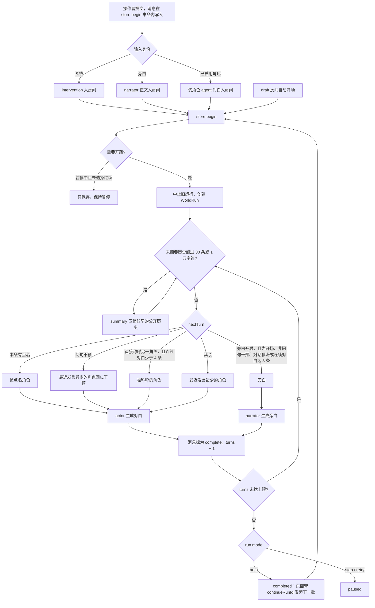
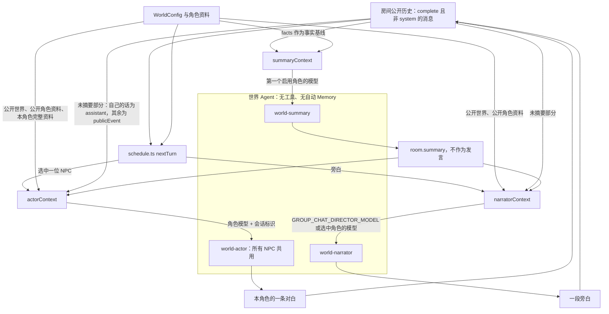
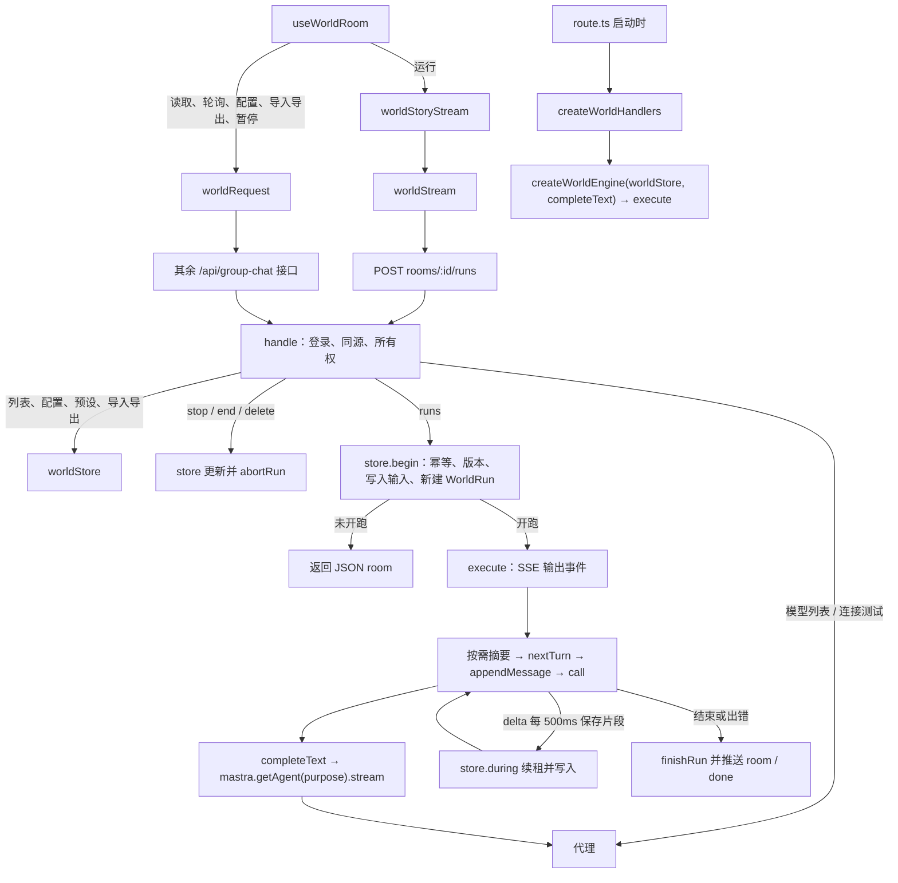
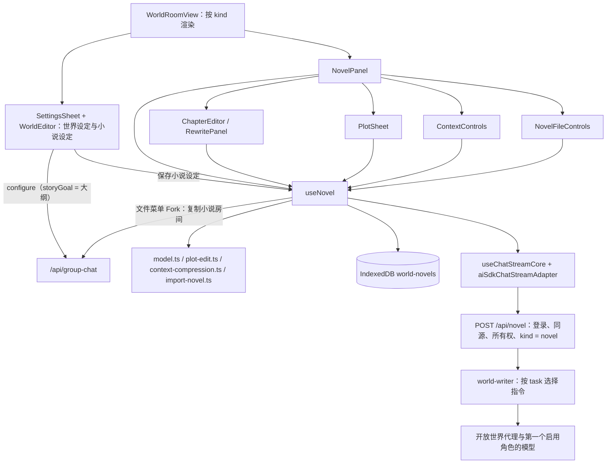
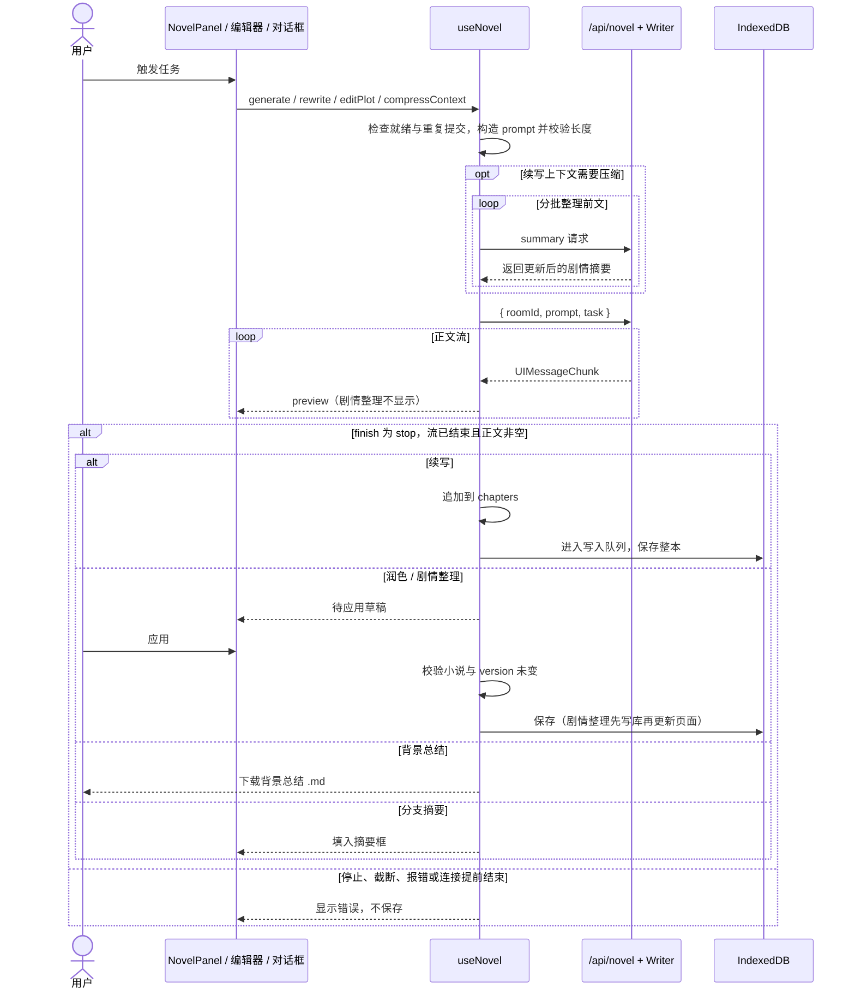

# 开放世界流程图

对应的文字说明见[剧本模式](./group-chat.md)、[小说模式](./novel-mode.md)和[运行架构](./architecture.md)。

## 剧本调度

从操作者输入，到选人、生成，再到下一批接续。

## 剧本角色与上下文

调度器如何为 actor、narrator 和 summary 分别组装上下文。

## 剧本接口与引擎

从页面请求进入 Route Handler，再到引擎执行、存档和结束。

## 小说模块关系

## 小说任务时序

续写、润色、剧情整理和总结都走同一条链路，差别在于完成后的处理方式。

