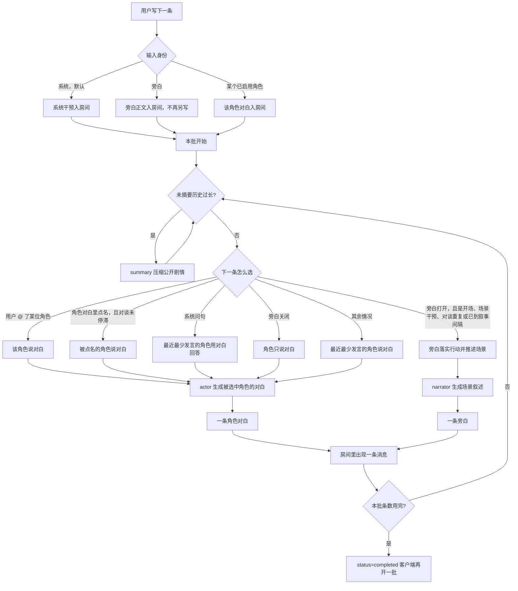
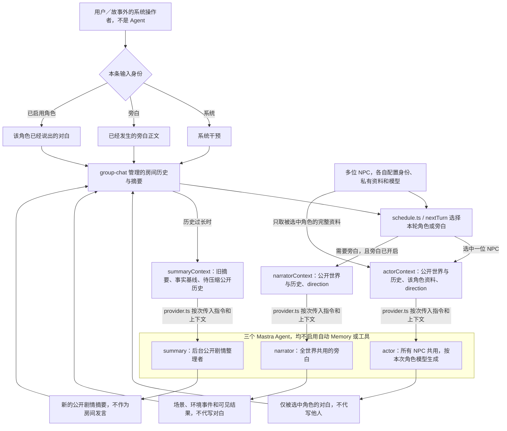
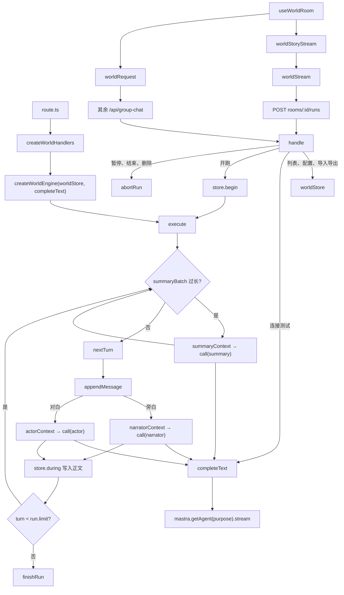
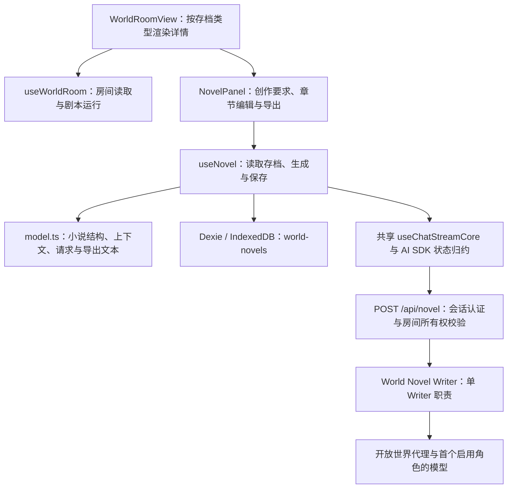
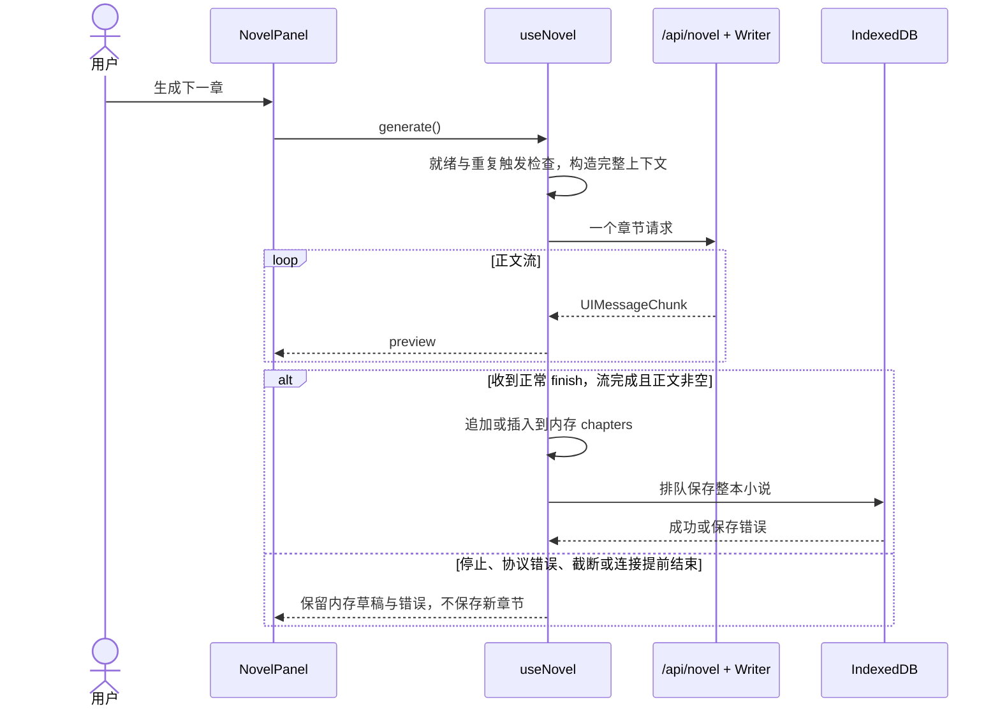
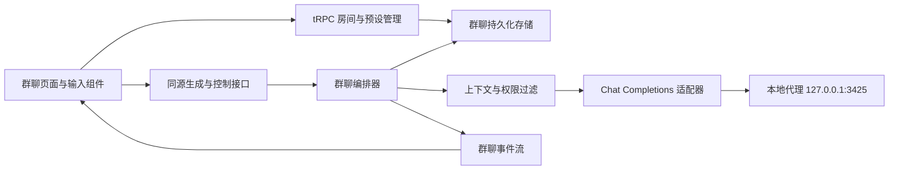

# 开放世界流程图

汇总剧本和小说的运行流程。对应的实现说明见[开放世界文档索引](./README.md)。

## 剧本调度

从操作者输入，到选人、生成对白或旁白，再到下一批接续。

## 剧本角色与上下文

展示调度器如何为角色、旁白和摘要组装各自的上下文。

## 剧本接口与引擎

从页面请求进入 Route Handler，再到引擎执行、存档和结束。

## 小说模块关系

展示小说面板、浏览器存档、生成接口和 Writer 的依赖关系。

## 小说章节生成

展示章节从发起请求、接收流式草稿到保存或终止的时序。

## 初版剧本设计

历史方案，保留了当时的 tRPC 和模型适配层设想。现行链路见上面的[剧本接口与引擎](#剧本接口与引擎)。

