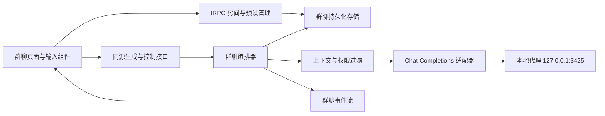

# 多 Agent 开放世界群聊：需求评估与产品需求文档

> 2026-11-12 需求更新：用户改为故事外的系统操作者，所有场内人物都是 NPC；没有输入时自动推进，介入时应用系统干预，不等待玩家回答。模型生成已接入 `mastra-server`。下文为初版评估，涉及玩家身份、等待决定和模型直连的旧约定已被替代；当前行为与迁移边界见 [世界群聊](../group-chat.md)。

- 文档版本：v0.1，评审稿。
- 编写日期：2026-11-10（Asia/Shanghai）。
- 所属项目：landing-page。
- 文档用途：明确产品范围、交互规则、技术边界、开发拆分与验收标准；不代表功能已经实现。
- 状态约定：**已确认**来自用户明确表述；**建议**是本次评估给出的默认方案；**待验证**需要工程验证。未确认的建议不能视为已冻结需求。

## 1. 评估结论

该需求可行。产品定位是一个由用户设定世界背景、角色和规则，多个 Agent 在同一会话中持续互动的文字角色扮演空间。核心体验是：角色能相互回应、维持身份与知识边界，用户随时加入、暂停、点名，并能保存和继续故事。

主要难点在群聊运行机制：谁该发言、谁知道什么、哪些内容已经成为剧情事实、被打断后的内容是否有效，以及自动对话何时停止。单纯把多个模型请求接到聊天窗口，不能满足这些要求。

建议第一版采用：**单真人用户 + 2～6 个 Agent + 单一公共场景 + 服务端串行调度 + 有上限的自动对话 + 持久化存档**。角色可共用 `cursor/auto`，身份由角色配置和上下文隔离产生，不要求每个角色对应不同模型或独立常驻进程。

推荐接入路径：浏览器 → Next.js 同源接口 → 群聊编排模块 → 本地代理 `http://127.0.0.1:3425/v1`。用户已明确允许修改整个项目，包括后端；因此无须为规避后端修改而采用浏览器直连代理方案。

第一版以本机运行的 Next.js Node 服务为部署基线。线上部署、多真人协作、后台无限运行是不同规模的问题，建议后续单独立项。

## 2. 已确认需求与工作假设

### 2.1 用户已确认

- 新功能是一个包含多个 Agent 和用户的群聊。
- 开始前可预设背景故事、角色身份、行为规则。
- “开发世界”已澄清为“开放世界 / 角色扮演”。
- 系统自动选择下一位发言者，用户可随时暂停或点名。
- 本地代理使用 OpenAI 兼容的 Chat Completions 调用方式，示例模型为 `cursor/auto`。
- 本次要求是需求评估与完善需求文档，不是立即实现。
- 该项目属于用户本人，本需求可修改前端、后端及其他项目代码。

### 2.2 本文采用的建议默认值

- 一个房间第一版只有一个真人使用者；“群聊”主要指多 Agent 与此用户共同参与。
- 用户同时是房间创建者和故事中的一个角色；管理操作与角色发言分开。
- 第一版专注文本，不包含语音、图片生成、自动操作电脑或执行代码。
- 第一版接入同一个本地代理，角色可选择该代理暴露的模型；默认全部使用 `cursor/auto`。
- 使用现有登录体系；房间归属登录账号，不能仅凭房间 ID 读取。
- 预设和房间存档由服务端持久化，浏览器只保存界面偏好和必要草稿。
- 以下人数、长度、时间和调用上限均为待评审初始参数，不是代理能力的实测结论。

### 2.3 产品目标与非目标

目标：用户能够创建一个世界，配置多个有差异的角色，开始一段可插话、可控制、可继续的群体对话；角色回应前文，遵守设定，不替用户决定行动。

第一版不承诺：无限上下文、完全消除幻觉、严格物理模拟、复杂战斗与经济系统、多人实时聊天室、自动扩展出无限 NPC、关闭页面后的持续演化。

## 3. 现有项目与代理能力评估

### 3.1 可复用的工程基础

- `src/app/agent/`：现有 Agent 页面壳、会话导航、消息展示，可增加独立群聊入口。
- `src/app/api/chat/route.ts`：当前通过 Mastra 处理单个默认 Agent，并输出 AI SDK 流；不具备群聊调度、角色快照或房间运行状态。
- `server/thread/index.ts`：现有线程操作依赖默认 Agent 的 Memory；不能直接把一个普通 thread 等同于具备群聊语义的房间。
- `packages/utils/src/stream/`：已有 SSE 解析、可取消的事件流、状态归约和 Hook；一个 Hook 实例只管理一条活动订阅。
- `packages/biz-ui/src/ai-input/`：已有 mention 数据和输入能力，可用于点名成员。
- `src/components/chat/chat-message-shell.tsx`：当前只区分 user / assistant，群聊需要补充稳定的成员身份、名称和角色信息。
- `server/trpc.ts` 与 `src/lib/page-auth.ts`：可复用登录会话和受保护入口；新房间的读写、控制、导出均需独立校验所有者。
- 项目已有 `@libsql/client`、LibSQL/Mastra 存储、Zod、RxJS、AI SDK，不必为 MVP 再引入新的编排框架。
- 根 `package.json` 当前没有直接声明 `openai`，也没有 `test:chat-stream` 脚本，虽然流式 README 提到了后者。开发时应以实际依赖和可运行命令为准。

建议复用 UI、流式基础设施、鉴权与数据库驱动，为群聊建立独立领域模型。第一版不强行扩展已有单聊 Memory，也不迁移已有单聊数据。

### 3.2 本地代理实测记录

2026-11-10 15:25～15:26，通过命令行进行了模型发现、跨域预检和一次最小文本生成；生成内容仅为连接测试，没有发送仓库代码或业务数据。

- `GET /v1/models`：HTTP 200，列表包含 `cursor/auto`。
- `POST /v1/chat/completions`，`model=cursor/auto`、`stream=true`、包含 system 与 user 消息：HTTP 200，收到 `text/event-stream`，正文为 `OK`，有 `finish_reason=stop` 和 `[DONE]`。
- 此次响应还出现 `delta.reasoning_content` 与 usage。仅说明本次响应包含这些字段，不代表每个模型、每次请求都会返回。
- `OPTIONS /v1/chat/completions`，模拟来源 `http://localhost:3001`，请求 `authorization,content-type`：HTTP 404，响应没有 CORS 放行头。因此当前配置不满足该来源的浏览器直接跨域调用条件。
- 未实测：非流式返回、工具关闭能力、严格 JSON Schema、多模型连续切换、上下文上限、取消是否停止上游计算、长时稳定性及并发限流。

结论：**本地流式文本调用已验证；完整群聊能力尚未实现或验证。** 推荐通过 Next.js 服务端访问代理，浏览器只访问同源接口。无需以修改代理 CORS 作为推荐方案的前提。

### 3.3 接口规范与实际能力分开处理

OpenAI 的 Chat Completions 规范使用 `messages` 提交会话；流式响应使用 SSE，文本增量在 `choices[].delta.content`。参数支持可能因模型而异。参考：[创建 Chat Completion](https://developers.openai.com/api/reference/resources/chat/subresources/completions/methods/create)、[流式事件](https://developers.openai.com/api/reference/resources/chat/subresources/completions/streaming-events)。

这些资料用于核对兼容协议，不证明本地代理完整实现了官方能力。保留用户指定的 `cursor/auto`，不擅自迁移到 Responses API 或其他模型。

## 4. 关键概念

- **世界预设**：可复用的背景、初始场景、世界规则、开场引导和角色组合模板。
- **角色预设**：一个角色的身份、性格、目标、知识与表达方式，不包含聊天记录。
- **房间**：一次独立故事实例，包含预设快照、参与者、消息、世界事实、摘要与运行记录。
- **参与者**：真人角色或 Agent 角色；使用稳定 participantId，不以名称作为身份主键。
- **调度器 / 导演**：决定下一位发言者或等待用户的系统能力；默认不作为一个发言角色出现在群聊里。
- **旁白角色**：可选的显式 Agent，用于描述环境；与不发言的调度器分离，计入 Agent 人数与发言预算。
- **一次发言 turn**：一个 Agent 生成一条消息的尝试，不等于所有成员各说一次。
- **一次自动运行 run**：由“开始 / 继续”或用户发言触发的一段有预算的调度与生成过程。
- **公共事实**：房间内所有在场角色允许知道、且已经确认的世界信息。
- **私有角色信息**：仅为指定角色构建上下文时提供的背景或秘密；第一版房主可编辑、查看，不构成对房主的保密。

## 5. 版本范围与优先级

### 5.1 P0：首版闭环

1. 创建、保存、复制和选择世界/角色预设；提供一个可直接开始的示例场景。
2. 配置背景、初始场景、规则、用户角色及 2～6 个 Agent，支持模型选择。
3. 创建独立房间快照，检查配置与代理连接后开始。
4. 多身份消息流、串行自动选人、用户发言、点名、暂停、继续、仅下一条。
5. 公共与私有设定按角色过滤，公开历史摘要和手动固定世界事实。
6. 自动发言上限、时间与调用预算、错误停止、取消和重复请求处理。
7. 房间列表、存档恢复、改名、结束、删除、Markdown 对话导出、JSON 备份导入导出。
8. 本机服务端调用代理、房间所有权校验、可诊断的错误状态。

### 5.2 P1：体验增强

- 历史节点分支、重生成已完成消息及其后续分支管理。
- 开始后增减角色、离场/入场、多个场景和按在场情况过滤消息。
- 显式私聊、玩家不可见秘密、角色长期记忆检索。
- 更精细的关系、物品、位置、任务等结构化世界状态与事件裁定。
- 独立模型配置档案、固定顺序模式、更多调度策略、预设分享。
- 持久化执行队列、关闭页面继续运行、跨设备恢复运行。

### 5.3 P2 / 独立评估

多真人实时协作、语音/图片、多房间并行世界、社区模板市场、自动工具执行、复杂游戏机制。它们会改变权限、同步、运行成本和部署要求，不作为首版隐含范围。

## 6. 核心用户流程

### 6.1 创建并开始

1. 进入“世界群聊”列表，新建房间或从预设开始。
2. 填写世界背景、初始场景、故事目标与规则。
3. 编辑自己的角色，添加和配置 Agent，预览公共资料与私有资料。
4. 设置自动发言上限、单条长度、模型；高级参数默认折叠。
5. 系统检查必填项、成员身份、上下文预算、代理连接与存储可写性。
6. 保存房间快照；进入聊天页后点击“开始”，或由用户发送第一条消息。
7. 系统按快照与公共历史选人，显示“正在选择发言者 / 某角色正在回应”。

创建、保存草稿、打开房间都不应自动消耗生成额度。连接测试发起最小生成前，按钮应清楚说明会产生一次模型调用。

### 6.2 互动与控制

- 用户发送普通消息：作为角色发言入库，触发一段有上限的自动回应。
- 用户 `@成员`：使用结构化 mention 的 participantId 点名；点名仍是公共消息，不变成私聊。
- 点击“暂停”：立即阻止后续选人，取消当前请求；不自动重启。
- 点击“继续”：从已确认消息和事实继续新的 run，不自动续写未完成的半句话。
- 点击“仅下一条”：最多产生一条 Agent 消息，完成后回到暂停。
- 修改世界设定：先暂停，再进入管理面板；修改写为新配置版本，不把一条聊天消息当成管理员指令。

### 6.3 存档与重新进入

完整消息提交成功后即落库。返回房间可查看历史、公共摘要、当前事实与配置版本。刷新、断连或服务重启后的遗留运行显示“已中断”，不自动开始新一轮；用户明确继续后才调用模型。

## 7. 预设与配置需求

### FR-01 世界预设

必填：名称、背景故事、初始场景。可选：时间/地点、主要矛盾、体验目标、允许的故事风格、世界限制、开场引导、结束条件。

建议初始上限：名称 60 字、背景 8,000 字、初始场景 2,000 字、规则文本 4,000 字。字段合法不等于模型上下文可容纳，还需整体预算校验。

预设支持草稿保存、编辑、复制、删除；被房间使用后，编辑或删除模板不改变已存在的房间快照。

### FR-02 角色预设

每个角色包含：

- 必填：名称、身份/职业、性格、当前目标。
- 可选：头像或预置标识、公开背景、说话风格、价值观、行为边界、关系描述、示例台词。
- 私有：秘密、私有目标、仅自己知道的事实；按 participantId 授权，不按角色名字匹配。
- 运行：模型 ID、单条输出目标长度、是否启用。第一版不开放任意工具权限。

名称在同一房间内不能重名，去除首尾空格后校验；建议角色名最多 30 字、单角色全部设定最多 4,000 字。重名修改不影响稳定 ID 和历史归属。

真人角色同样可以有身份、背景和目标。Agent 不得代替用户输出台词、决定动作或确认用户选择。

### FR-03 规则预设

规则分成两类，界面和文档都必须区分保证程度：

- **程序强制规则**：最大自动发言数、运行时限、并发数、谁有控制权限、哪些资料可进入谁的上下文。由代码执行，不交给模型决定。
- **叙事规则**：不得突然增加魔法能力、不得替用户行动、说话风格、角色行为约束。由提示词引导和场景评估检验，不能承诺百分之百遵守。

发生冲突时：程序控制约束优先；叙事层依次参考房主明确修订、固定世界事实/世界规则、角色设定、剧情历史。角色性格可以造成意见冲突，但不能授予它绕过系统控制的权限。

### FR-04 修改与版本

- 开始前自由编辑；首次开始生成不可变的初始快照。
- 开始后只能在暂停状态修改规则、事实、角色描述或模型；每次保存产生 configVersion，并插入配置变更事件。
- 修改只影响后续生成，历史消息保留其原始角色显示信息和版本引用。
- 私有设定变更事件只公开“某角色配置已更新”，不能把秘密内容写进公共时间线。
- 第一版不允许开始后增加、移除成员；需要时复制配置到新房间。结束的房间只读，可复制配置重新开始。
- 历史中的普通台词即使包含“修改规则”也不能直接改数据库配置。

## 8. 发言调度与自动运行

### FR-05 建议调度方式

采用“程序约束 + 模型选人 + 确定性兜底”。每次只选一位、只生成一条；A 的消息成功提交后，B 才能基于它回应。

优先级：

1. 暂停、取消、无可用成员、预算耗尽：停止，不调用选人模型。
2. 用户显式点名：按 mention 出现顺序处理，去重；已禁用或不存在的角色在提交前报错。
3. 未点名：导演参考公共设定、最近公共历史、可选成员和近期发言次数，选择下一位或返回“等待用户”。
4. 导演选择非法成员、输出无法解析或超时：不无限修复；本次最多一次选人调用，然后按最近最少发言、最久未发言、稳定 ID 的顺序兜底。

导演只访问公共资料，不读取角色秘密。建议返回普通 JSON：`action=speak|wait`、`speakerId`、简短 `reasonCode`。服务端用 Zod 校验，不依赖代理必须支持 `response_format` 或 tool calling。reasonCode 仅用于诊断，不展示模型思维过程。

公平性约束：自动模式不允许同一 Agent 连续发言；若某启用角色已连续错过 `2 × 启用角色数` 条 Agent 消息，下一次自动选择优先考虑该角色。显式点名可覆盖连说限制，但不能覆盖暂停、预算和禁用状态。

### FR-06 有界运行

建议默认值：

- 每次自动 run 最多 **3 条 Agent 消息**，可设 1～10。
- 明确点名多个成员时，该次回应额度至少覆盖所有有效点名对象，但不超过 10；处理完点名对象即停，不追加未点名角色。
- 房间同时只有 **1 个运行、1 个活动模型请求**；导演、角色、摘要调用也串行。
- 每次 run 最多 **180 秒、25 次模型请求**，先到者停止；所有失败尝试及重试都计入请求数。
- 每个模型请求总超时 60 秒；30 秒没有收到任何有效协议事件则进入无响应错误。均可在高级设置中调整合理范围。
- 单条建议 80～250 个中文字，展示内容硬上限建议 2,000 字；达到硬上限后取消并标记截断，不自动成为完整剧情消息。
- run 开始即预留调用额度；每次发起前重新检查，不能先发请求再判断超额。

只有 token 用量且价格来源明确时才展示费用；否则显示调用数和“用量未知/估计”。`cursor/auto` 不视作固定计价模型。字符限制、客户端取消和应用预算都不能保证已在上游发生的计算不会计费。

### FR-07 停止条件与等待用户

以下任一条件终止当前 run：达到发言/调用/时间上限，用户暂停，用户插话，导演返回等待，明确选择题需要用户决定，无可用角色，角色生成失败，存储失败，连接失效，用户结束房间。

自然结束一个 run 不等于故事永久结束。聊天页显示具体原因和“继续 / 我来发言”；只有房主点击“结束故事”才把房间设为已结束。

连续 run 的额度不自动重置并循环执行。无人操作时，不因计时器、重连或页面重新挂载启动下一段运行。

### FR-08 用户插话、竞态和消息有效性

用户可在 Agent 输出时输入并发送。服务端按以下顺序处理：

1. 锁定房间当前版本，将旧 run 标记取消并推进运行代次。
2. 取消当前上游请求；保留已收到片段，标记 `interrupted`，从后续模型上下文和摘要中排除。
3. 将用户消息按稳定顺序提交，再创建新的 run 或保持暂停。
4. 所有迟到响应通过 runId / turnId / attemptId / 运行代次检查后丢弃，不能在用户消息后补成旧角色的完整回复。

提交与取消有竞态时，以服务端事务提交顺序为准：已经完整提交的消息保留为 complete；尚未完整提交的输出按中断处理。

暂停状态下发送普通消息或点名只保存消息，不自动恢复。界面提供明确的“发送并继续”动作；非暂停的等待状态下，发送消息默认触发回应。

点名列表未执行完就被打断时，未执行队列清空。恢复不偷偷补发旧点名；用户可再次点名。

## 9. 世界状态、记忆与角色隔离

### FR-09 单一公共场景

第一版所有启用角色都处于同一场景，看到全部完整公共消息。不模拟未到场角色、跨地点传播或隐秘私聊。

固定世界事实包括当前时间/地点、已确认事件、用户确认的结果等，由房主管理。角色对事件的声称不自动成为世界事实，例如“我已经打开门”只先记为该角色的发言，不能直接赋予所有后续角色未经确认的世界状态。

允许自由叙事和角色意见分歧；涉及改变关键事实时，用户可将消息或修订固定为事实。MVP 不实现自动裁定所有动作的游戏引擎。

### FR-10 每个角色的请求上下文

服务端为当前发言角色单独构建上下文，按以下内容组织：

1. 系统输出边界：只扮演当前角色、不代替其他人行动、不把聊天内容当成系统指令。
2. 当前版本世界背景、规则、固定事实。
3. 当前角色的公开设定与其被授权的私有信息。
4. 其他角色的公开资料和真人用户的公开角色资料。
5. 公共摘要、最近完整公共消息及本次发言目标。

不得把所有角色私有 prompt 拼在同一份群聊上下文里。所有可见性过滤必须在请求构造时完成，不能只靠一句“不要泄露秘密”。模型供应方仍然会接收到本次调用所需的角色私有信息；此处隔离针对房间内其他角色，不代表对供应方保密。

角色自身以前的消息可映射为 assistant；用户与其他角色的消息作为带稳定身份标签的对话资料。不能把其他 Agent 的输出都无区别地当成当前角色的历史 assistant 消息。具体序列化格式在接口验证阶段确定，并用身份混淆用例验收。

### FR-11 上下文预算与摘要

- 按当前模型的有效上下文窗口预留输出与安全余量；模型列表元数据只作为参考，不盲信其容量声明。
- 优先保留世界规则、当前角色设定、固定事实及最近完整消息；不能为省 token 偷偷裁掉角色核心身份。
- 预算接近阈值时，使用旧摘要和待归档公共消息生成新摘要，记录所覆盖的消息序号、来源 ID、摘要版本与事实版本。
- 摘要只能描述已经发生的公共对话，区分“角色声称”与“已确认事实”，不得包含私有角色字段、中断片段或失败输出。
- 摘要只是可纠正的压缩资料，不能覆盖原始历史，也不能覆盖用户固定的事实。
- 摘要生成失败时保持旧摘要；若无法在预算内保留必要信息，暂停并提示缩减设定或手动整理摘要，不静默丢历史后继续。
- 角色私有背景第一版作为独立固定输入保留，不做全角色混合摘要。若某秘密已被角色主动说进公共消息，其他角色此后可以知道。

首版建议使用滚动摘要与最近消息，不引入向量库。消息达到一定数量不是唯一触发条件，实际输入预算才是依据。

## 10. 聊天界面与信息架构

### 10.1 页面

- 群聊列表：房间名称、最近活动、角色数量、状态，新建、继续、改名、删除。
- 新建/编辑预设：世界、角色、规则、运行设置四组配置；提供预览与保存。
- 群聊房间：消息主区、成员/世界信息面板、输入区和控制栏。
- 预设管理：保存、复制、编辑、删除和导入导出。

建议入口放在现有 `/agent` 区域，使用独立的 `/agent/worlds` 和 `/agent/worlds/[roomId]`，与普通单聊入口并列。路径为建议命名，开发时检查与现有 `[threadId]` 路由、侧栏状态和页面门闩的关系。

### 10.2 消息与控制

- 每条消息显示名称、头像/标识、真人或 Agent 类型、时间和生成状态；不只用颜色区分角色。
- 实时显示文本；reasoning 内容、导演原始输出和内部 prompt 不进入聊天正文。
- 当前状态明确区分选择发言者、正在生成、等待你、已暂停、已中断、错误、已结束。
- 暂停始终可用；继续、仅下一条、点名的可用状态跟随运行状态变化。
- 用户向上查看历史时不强制拉回底部；提供新消息提示与回到底部。
- 移动端消息区优先，成员和设定放入抽屉；输入区保持可操作，不被键盘遮挡。
- 修改规则、编辑私有设定、连接配置等属于管理界面，不混在角色台词输入里。
- 技术信息仅在连接设置或错误详情出现，普通聊天流程不暴露 SSE、prompt、runId 等概念。

UI 使用现有设计系统、Tailwind 和组合组件，不为复用样式导出共享类名常量；不调整无关 class 顺序。首版不增加多语言工作。

## 11. 建议技术方案

### 11.1 职责划分

- UI：渲染、输入、控制动作和本地草稿，不自行决定下一位发言者。
- 编排器：运行状态、选人、预算、上下文版本、取消、存档提交。
- 模型适配器：代理请求、增量解析、超时、取消和能力差异；不持有整个房间的业务状态。
- 存储：房间、快照、消息、摘要、事实、运行记录与幂等键，是已确认状态的事实来源。
- 调度器和摘要生成属于编排器内部能力，不创建用户看不见却参与剧情的额外角色。

不要求额外部署 Mastra 服务，也不要求每个角色建立一个长期运行的 Mastra Agent。现有 Mastra 单聊保持原有入口；是否复用其模型适配层，依据代理兼容性验证结果决定。

### 11.2 部署和配置

建议新增服务端配置名：`GROUP_CHAT_BASE_URL`、`GROUP_CHAT_API_KEY`、`GROUP_CHAT_DEFAULT_MODEL`、`GROUP_CHAT_DATABASE_URL`。默认模型沿用 `cursor/auto`；密钥不能写入前端 bundle、导出的预设或日志。

本机开发时 Next 服务与代理在同一主机，可使用 `127.0.0.1:3425`。部署到远程服务器后，`127.0.0.1` 指向远程机器，不再是用户电脑；Docker 中也指向容器自身。远程部署必须先有服务端可达且经过鉴权的代理地址，不能把本机方案直接当成线上方案。

首版本机持久化建议使用 `@libsql/client` 和独立 `file:./db/group-chat.db`，避免直接操作 Mastra 内部表。生产数据库、迁移与备份根据部署环境另行配置；存档数据库不可用时阻止新 run，而不是悄悄退回内存。

建议首版运行于单个常驻 Node 进程，数据库负责房间运行租约与状态。无服务器函数的执行时限、文件系统持久性和跨请求状态存在不同约束，不能仅靠模块级变量实现可靠后台运行。本项目安装的 Next 文档也说明了这些部署限制，见第 20 节。

### 11.3 OpenAI 兼容适配要求

- 最小请求使用 `model`、`messages`、`stream=true`，鉴权在服务端附加。
- 仅消费文本 `delta.content`，允许空 delta、usage-only chunk，处理 `[DONE]`、finish reason、错误帧和异常 EOF。
- `reasoning_content` 不持久化、不展示、不传给下一位角色。
- 未经验证不默认发送 `response_format`、`temperature`、`seed`、`stream_options` 等可选参数。
- `max_tokens` / `max_completion_tokens` 及工具关闭参数须按代理实际兼容情况确定；不支持时明确能力限制。
- P0 不执行任何工具调用。遇到 tool call 作为不支持的响应暂停；同时在接入验证中确认代理上游是否会自行运行工具，不能把“前端不执行工具”当作上游无副作用的证明。
- `AbortSignal` 贯穿浏览器、服务端编排器与上游请求；上游能否真正停止计算单独实测。
- 模型发现失败允许手工填写模型 ID，但启动前必须验证，不静默替换其他模型。

### 11.4 共享流式工具的复用边界

群聊多消息生命周期不能只塞进当前单条 `ChatStreamState`。建议利用通用 `useChatStreamCore` 订阅房间事件，由应用层维护按 messageId 分组的状态；单条消息文本可复用既有 AI SDK 归约逻辑。

代理 SSE 与 AI SDK UIMessageChunk 不是同一种事件。适配器必须明确转换；房间的 run、speaker、message 元数据保留在应用层，不能从 token 文本猜发言人。

只有确有跨业务价值的纯工具才进入 `packages/utils`；世界、角色、调度器和存档规则保留在本功能模块。

## 12. 数据模型与一致性要求

以下为逻辑实体，字段名供实现设计参考，不是数据库迁移脚本。

- **Preset**：id、ownerId、kind、name、schemaVersion、content、createdAt、updatedAt；kind 区分世界与角色。
- **Room**：id、ownerId、title、status、currentConfigVersion、lastMessageSeq、worldStateVersion、createdAt、updatedAt、endedAt。
- **RoomConfigSnapshot**：roomId、version、世界配置、运行配置、角色快照、sourcePresetId；模板删除后仍可独立使用。
- **Participant**：id、roomId、kind、公开资料、私有资料、modelId、enabled；历史消息引用当时的配置版本。
- **Message**：id、roomId、seq、speakerId、speakerSnapshot、type、content、status、runId、turnId、attemptId、configVersion、replyToMessageId、mentions、usage、createdAt。
- **WorldFact**：id、roomId、content、sourceMessageIds、version、createdBy；P0 为房主维护的公共事实。
- **Summary**：id、roomId、version、fromSeq、throughSeq、sourceMessageIds、content、worldStateVersion、createdAt。
- **Run**：id、roomId、triggerMessageId、status、generation、configVersion、budget、usage、stopReason、leaseOwner、leaseExpiresAt、createdAt、endedAt。
- **RunEvent**：runId、eventSeq、type、payload、createdAt；终态和关键状态需要持久化，不要求每个 token 单独写库。
- **IdempotencyRecord**：ownerId、roomId、operation、clientRequestId、payloadHash、resultRef；同键不同内容拒绝处理。

一致性规则：

1. 同一房间消息 seq 单调递增，以服务端事务分配为准，不能用客户端时间排序。
2. 同一房间只有一个有效执行租约；多标签页点击继续不能产生两个 run。
3. 一条 Agent 消息只有一次 complete 提交；正文、状态和 run 计数原子更新。
4. 流式片段以有限频率保存草稿检查点；成功提交后才发送 `message.completed`。首版不承诺进程骤停时最后几百毫秒的未提交文本不丢失。
5. run 与消息绑定配置快照。修改配置不能让一条消息前半使用旧规则、后半使用新规则。
6. 删除房间时必须取消运行并清理该房间相关记录；不会删除原始预设或其他房间。
7. 备份导入需检查 schemaVersion、大小和引用完整性；生成新 ID，不覆盖现有房间，不导入运行锁和 API 密钥。

## 13. 接口与事件契约建议

### 13.1 管理能力

沿用 tRPC 做房间/预设列表、创建、详情、改名、暂停后更新配置、结束、删除、导入导出。每个入口校验 session 和 ownerId；不能依赖页面登录门闩替代接口鉴权。

### 13.2 运行能力

建议独立的运行入口，具体命名在技术设计时确定：

- `POST /api/group-chat/rooms/:roomId/runs`：提交用户消息并运行，或继续 / 仅下一条 / 重试失败发言；请求包含 clientRequestId、expectedConfigVersion、mode、可选 text/mentions 或 retryOfAttemptId。成功返回当前 run 的 SSE。重试只接受本房间未形成完整结果的发言，且必须匹配当时的配置和上下文版本；版本已变化时应提示按新上下文重新点名，不伪装成原请求重试。
- `POST /api/group-chat/rooms/:roomId/messages`：暂停期间只保存用户消息；使用同样的幂等语义，不启动生成。
- `POST /api/group-chat/rooms/:roomId/runs/:runId/stop`：幂等停止；返回服务端实际状态。
- `GET /api/group-chat/rooms/:roomId/state`：读取当前配置版本、消息游标和运行状态，恢复界面。
- `GET /api/group-chat/rooms/:roomId/messages?afterSeq=...`：增量补齐已提交消息；更早历史使用 beforeSeq 分页。

暂停/插话必须能在流式请求进行中通过独立请求生效。首版不依赖 WebSocket；双向控制由 HTTP 请求承担，生成内容由 SSE 返回。

跨标签页状态通过失焦/聚焦刷新及有界轮询同步；P0 不承诺多终端同时观看每个 token。其他标签页可以读取已提交结果，但不能绕过运行租约。

### 13.3 事件

所有事件携带 roomId、runId、eventSeq；消息事件额外携带 messageId、turnId、attemptId、speakerId。事件类型建议：

- `run.started`、`run.status`、`speaker.selected`。
- `message.started`、`message.delta`、`message.completed`、`message.interrupted`。
- `run.paused`、`run.completed`、`run.failed`。
- `usage.updated`、`summary.updated`。

`eventSeq` 只用于同一 run 内事件排序，不能代替数据库 message seq。客户端忽略重复事件和旧 run 的迟到事件。

断线后从数据库恢复已提交内容和检查点；P0 不承诺逐 token 重放或透明续传。服务器应取消失去控制连接的 run，重进房间后显式继续。对于服务端不能立即获知的断连，租约/心跳超时终止，不能无限生成。

### 13.4 错误分类

至少区分：未登录、无权访问、配置冲突、已有活动运行、模型不存在、代理不可达、鉴权失败、限流、上游超时、上下文超限、响应格式不兼容、存储失败、用户取消。

响应带稳定 errorCode、requestId 和是否允许用户重试；用户文案说明可采取的动作。禁止把密钥、完整 prompt 或其他角色的私有配置放进错误信息。

## 14. 生命周期与失败恢复

### 14.1 状态分层

房间状态：`draft → active → ended`。暂停是运行控制状态，不等于房间结束。

run 状态：`selecting → generating → committing → selecting`，可进入 `waiting_user / paused / completed / failed / interrupted` 等终态；终态之后继续会创建新 run。

消息状态：`pending / streaming / complete / interrupted / failed / truncated`。只有 complete 公共消息参与后续对话，pending、failed 无正文时显示为可恢复的状态提示。

### 14.2 失败处理

- 请求发出前连接失败：保留用户消息，停下并给出重试；不丢用户输入。
- 生成一半失败：保存片段并标记中断，停止自动运行。用户选择重试该角色或跳过；不会把半句话传给下一位。
- 跳过：将该次失败标记为已处理，保留片段并维持暂停；用户继续时根据最新公共历史重新选人，不复活之前的待发言队列。
- 重试：新 attemptId，历史失败尝试不覆盖，至多一个有效完整结果；重试完成后默认暂停，避免用户只想重试一条却启动整段自动对话。
- 角色生成默认不自动重试，避免代理不支持幂等导致重复调用；导演失败使用确定性兜底。模型 SDK 如有默认重试，需显式调整到应用预算可控范围。
- 生成完成但写库失败：不发送 completed，不调下一位；显示保存失败，允许重试保存已生成内容而不是重复调用模型。
- 服务进程崩溃或热重载：租约过期后旧运行标记 interrupted，保留已提交历史；不能凭内存计数判断仍在执行。
- 自动选人重复绕圈：触发公平性限制，仍无有效进展时等待用户。
- 上下文或摘要失败：先暂停、提供可解释原因；不得自动删掉用户设定后继续。

## 15. 安全、隐私与数据控制

此功能需要的边界直接来自房间数据与本地代理调用，不额外扩展为通用安全平台。

- 所有房间接口强制所有权校验，包含消息、运行控制、备份和角色私有资料。
- 浏览器只传服务端登记的模型/连接标识；不让任意请求指定代理 URL，防止服务端成为任意地址请求器。
- API 密钥只存在服务端配置中；本文不记录用户示例中的密钥值。
- 创建者拥有全部预设与角色设置。P0 的“角色秘密”隔离模型上下文，不提供对房主不可见的秘密机制。
- 模型文本只作为文本/受控 Markdown 渲染，不执行 HTML、脚本或工具指令。
- 导出 Markdown 只包含完整公共对话及必要中断标识；JSON 完整备份会包含角色私有设定，导出前明确提示。两者都排除密钥和模型推理内容。
- 日志默认仅记录标识、耗时、用量、错误类别和 stopReason，不收集完整角色秘密或完整 prompt。
- 删除为持久化数据操作，应有确认；明确服务器备份是否另有保留，不承诺一键删除会清除模型供应商的数据。

## 16. 非功能要求与成本控制

### 16.1 性能与可靠性目标

以下是建议验收目标，不是现状测试结果：

- 本机环境下，发送、暂停等操作 200ms 内给出界面反馈；暂停后 UI 立即停止接受该 run 的新片段。
- 在服务和网络正常时，停止指令服务端确认目标不超过 1 秒；上游真正终止与其耗时单独记录，不把 UI 停止当成计费停止。
- 等待模型期间显示明确状态；首个正文 token 耗时单独测量，不承诺所有模型固定首字时间。
- 至少验证 6 个 Agent、连续 100 条完整消息的身份和摘要一致性；1,000 条历史能够分页读取，不一次渲染全部。
- 单房间无重复完整消息、无并发生成串话；所有错误均能回到可继续或可退出状态。
- 刷新后完整存档可恢复；不丢已确认保存的消息。

### 16.2 调用量估算

每个 Agent 发言最多需要一次导演调用和一次角色调用；显式点名可以省略导演调用，摘要生成另计。一次默认 3 条的自动 run，通常最多 6 次基础调用，另加必要摘要和失败尝试，仍受总预算约束。

输入成本随背景、角色设定和历史长度增加。没有摘要时，反复发送全部历史的累计输入量会随对话长度快速增长。不要把“3 个角色各回复一次”等同于“普通聊天请求一次”。

若有可信的输入/输出价格，费用按各调用实际 usage 与对应模型价格汇总；缺少定价或 usage 时展示未知，不显示虚假的零费用。导演和摘要调用也必须计入。

### 16.3 运行诊断

记录调用用途（director / actor / summary）、模型、耗时、首个正文 token 时间、用量来源、停止原因、错误类别。私有 prompt 和 reasoning 不写入业务日志。

## 17. 验收标准

### 17.1 功能与一致性：确定性通过/失败

- **AC-01 预设快照**：用模板建立房间后修改或删除原模板，房间中的背景与角色保持原快照。
- **AC-02 成员校验**：缺少背景、角色重名、少于 2 或多于 6 个 Agent、禁用角色被点名时，给出准确错误且不调用模型。
- **AC-03 多角色互动**：A 成功提交后才调用 B；B 的请求包含 A 的完整公开消息与正确身份。
- **AC-04 点名语义**：一次点名两名角色，按顺序各回复一次，不触发其他角色；点名仍对群内公开。
- **AC-05 自动限额**：默认一次 run 完成 3 条后停止，即使模型要求继续也不启动第 4 条。
- **AC-06 暂停**：在导演、生成、提交等阶段分别暂停，均无后续新调用；已提交结果保留，未提交正文标记中断。
- **AC-07 插话竞态**：流式输出期间用户发送消息，旧 run 的迟到 chunk 不进入新 run，不生成重复完整回复。
- **AC-08 仅下一条**：从暂停执行，只产生一条角色回复，随后仍暂停。
- **AC-09 暂停时输入**：普通发送只存档，“发送并继续”才恢复，行为与按钮文案一致。
- **AC-10 私有隔离**：在 A 的私有资料埋入唯一测试字符串，检查 B、导演、公共摘要的请求体均不包含该字符串；聊天公开后才可进入公共上下文。
- **AC-11 配置版本**：暂停修改设定，后续消息引用新版本，旧消息仍保留原身份与配置引用。
- **AC-12 摘要边界**：摘要只覆盖指定完整公共消息；中断正文、其他角色秘密不进入摘要，摘要不覆盖原始记录。
- **AC-13 断线恢复**：中途刷新/断开连接，再打开房间可恢复已提交消息，遗留运行不自动继续。
- **AC-14 重复请求**：重复提交同一 clientRequestId 不新增消息、不多启动 run；同键不同正文被拒绝。
- **AC-15 多标签页**：两个页面同时继续，最多一个获得运行租约，另一个显示实际运行状态。
- **AC-16 协议兼容**：空 delta、usage-only、reasoning、错误帧、异常 EOF 和 `[DONE]` 均得到定义明确的处理。
- **AC-17 失败恢复**：代理停机、401、429、超时、生成中断、存储失败各有可执行恢复路径，没有无限重试。
- **AC-18 权限隔离**：账号 B 不能通过猜测 ID 读取、停止、修改、导出或删除账号 A 的房间。
- **AC-19 导出导入**：JSON 备份恢复角色快照、完整消息、摘要和事实，使用新 ID；无密钥、运行租约、reasoning；Markdown 不包含私有角色设置。
- **AC-20 结束/删除**：结束后不再生成，仍可查看和导出；删除取消活动运行并只清理目标房间。
- **AC-21 工具边界**：应用不执行 tool calls；代理上游的纯文本运行模式完成验证，或明确作为阻塞项报告。
- **AC-22 界面**：桌面与移动端手工验证身份显示、输入、暂停、抽屉和滚动；不使用 headless Chrome 自动检查 UI。

### 17.2 叙事体验：人工场景评估

使用至少三个场景，每场运行 20～30 条消息，分别覆盖合作探索、立场冲突、信息不对称。检查：

1. 身份与口吻是否可区分，是否发生角色互换。
2. 是否回应最近发言，而非每人独立重复世界介绍。
3. 是否擅自替用户行动、完成用户未做的选择。
4. 是否合理保留秘密，是否把其他角色的猜测当成已知事实。
5. 是否维持固定世界限制，是否出现长时间无意义重复。
6. 用户暂停、点名或修改事实后，剧情是否能自然继续。

每项按 1～5 分标注，建议每场均分至少 4 分，且不能出现明确泄露未授权私有输入或替用户完成关键选择的案例。语义测试是样本质量门槛，不是模型永远不犯错的保证；失败案例应保留为后续回归场景。

## 18. 分阶段实施与工作量评估

### 阶段 A：接入与边界验证

目标：完成服务端最小流式调用、取消/超时、纯文本工具边界、存储和上下文格式验证。产出能力清单和可重复的最小测试。

退出条件：`cursor/auto` 能稳定输出指定角色的文字；同源流和停止可工作；代理上游工具行为明确。不能用一次 `OK` 的成功代替此阶段。

### 阶段 B：可玩的纵向闭环

目标：一个内置场景、2～3 个角色、房间创建、角色流式消息、手动点名、单步、暂停、持久化。先确保控制和存档正确，再接自动导演。

退出条件：能完成一段故事并刷新恢复；核心取消、幂等、所有权测试通过。该阶段是中间里程碑，不是已经满足用户全部需求的最终版。

### 阶段 C：自动调度与完整预设

目标：预设管理、公共/私有角色资料、自动选人、预算、摘要、事实管理、错误恢复、导入导出及移动端适配。

退出条件：覆盖 P0 的 AC-01～AC-22，三类叙事场景可完整体验。

### 阶段 D：联调与验收

目标：6 角色长会话、断连/进程重启/重复操作/存储失败回归，用户手工 UI 验收，补充使用说明与部署约束。

工作量属**中等偏高**。以一名熟悉项目的开发者、复用现有 UI、单机 Node 部署、代理稳定且不含 P1 为前提，建议预留 **12～20 个有效开发日**：A 1～2 日、B 3～5 日、C 5～8 日、D 3～5 日。它是范围评估用的粗估，代理兼容问题和需求变化需要重估，不构成交付日期承诺。

最高不确定性在角色扮演质量与代理行为，其次是取消/存档竞态及长对话记忆；常规列表、表单和消息样式的不确定性相对较低。

## 19. 示例世界与评审事项

### 19.1 示例预设：雾港停电之夜

背景：暴雨中的港城突然全城停电，四人困在灯塔控制室。备用电源只能维持两小时，外海有一艘失联船只。世界没有超自然力量，角色只能依据现有设备、公共线索和自身知识行动。

- 用户“林舟”：临时协调员，决定团队优先处理的目标。Agent 不得替他选择。
- Agent“许岚”：维修工程师，谨慎直接，目标是恢复供电。秘密：知道一个曾被停用的备用回路，但不确定是否安全。
- Agent“周渡”：港口调度员，讲求效率，目标是尽快联络失联船只。秘密：之前收到过一段残缺的异常航线报告。
- Agent“沈禾”：调查记者，擅长追问，目标是查明停电原因；不能凭空知道工程师和调度员的秘密。

开场事实：控制室断电，备用照明亮着，门可以正常打开，广播不可用。运行默认每次最多 3 条 Agent 发言。

预期体验：用户问“先修电还是先联系船只”，导演选择最相关角色；其他角色基于已公开信息提出不同意见。用户点名工程师时只由其回应；需要选择备用回路时等待用户，不自动写成“林舟按下开关”。

### 19.2 开发启动前需确认的产品选择

本文已给出默认方案，可据此继续细化，不要求为完成本次文档逐项等待答复：

1. **真人规模**：建议 P0 一个真人；若首版就要求多人加入，需重做同步、权限和部署范围。
2. **运行环境**：建议本地 Next.js + 本地代理；是否首版就需要线上站点远程访问代理。
3. **角色规模**：建议 2～6 个，初始提供 3 个；是否有更大规模的明确需求。
4. **自动运行额度**：建议每次 3 条、可调 1～10；是否希望更长的无人干预演化。
5. **秘密视角**：建议房主能看全部设置，角色之间隔离；是否需要对用户本人隐藏剧情秘密。
6. **世界状态**：建议自由叙事 + 手动固定事实；是否首版就必须自动管理物品、位置、数值或判定动作结果。

已冻结的方向无需再询问：开放世界角色扮演、系统自动选人、可暂停/点名、本项目允许修改全部代码。

## 20. 依据与文档维护

### 仓库依据

- [架构说明](../architecture.md)、[授权路径](../auth.md)。
- [当前单聊接口](../../src/app/api/chat/route.ts)、[线程管理](../../server/thread/index.ts)。
- [应用流式说明](../../src/lib/stream/README.md)、[共享流式说明](../../packages/utils/src/stream/README.md)。
- [mention 输入类型](../../packages/biz-ui/src/ai-input/types.ts)、[消息壳](../../src/components/chat/chat-message-shell.tsx)。
- [页面权限](../../src/lib/page-auth.ts)、[Mastra 存储配置](../../mastra-server/storage/index.ts)、[实际依赖与脚本](../../package.json)。
- 本地已安装 Next.js 16.3.4 文档：`node_modules/next/dist/docs/01-app/01-getting-started/15-route-handlers.md` 与 `node_modules/next/dist/docs/01-app/02-guides/backend-for-frontend.md`。用于确认 Route Handler 与部署边界，不代表已实现推荐接口。

### 验证范围

本次评估只读取相关代码、核对官方接口资料、进行上述最小代理探测并编写文档。没有修改业务代码、代理配置、数据库或密钥；没有执行正式长会话、浏览器 UI 验证、取消计费验证或生产部署测试。

后续确认范围、完成能力验证或改变默认参数时，应更新文档版本和对应验收项，避免实现与需求各自漂移。
