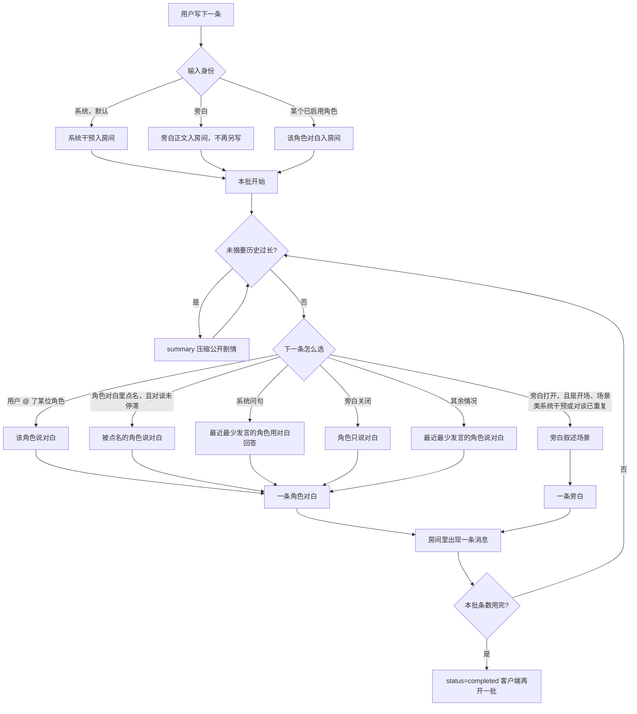

房间里有三类发言：多位 NPC 只说对白，系统只有一个，旁白只有一个。

用户输入默认是系统。输入框上方可以把这一条改成旁白，或改成任意已启用的角色。写下的内容先入房间，再按下图为后续发言选人。

- 系统：这一条是干预。问句交给角色用对白回答；旁白打开时，场景类干预由旁白叙述。
- 旁白：这一条就是旁白正文，不再另写一条旁白。
- 角色：这一条就是该角色已经说出的对白。接下来由其他角色接话；句中点名或 @ 仍优先交给被点到的角色。

`narration` 默认关闭。打开后，开场、场景类系统干预和已经重复的对谈才由旁白叙述。问句干预和点名始终交给对应角色。

