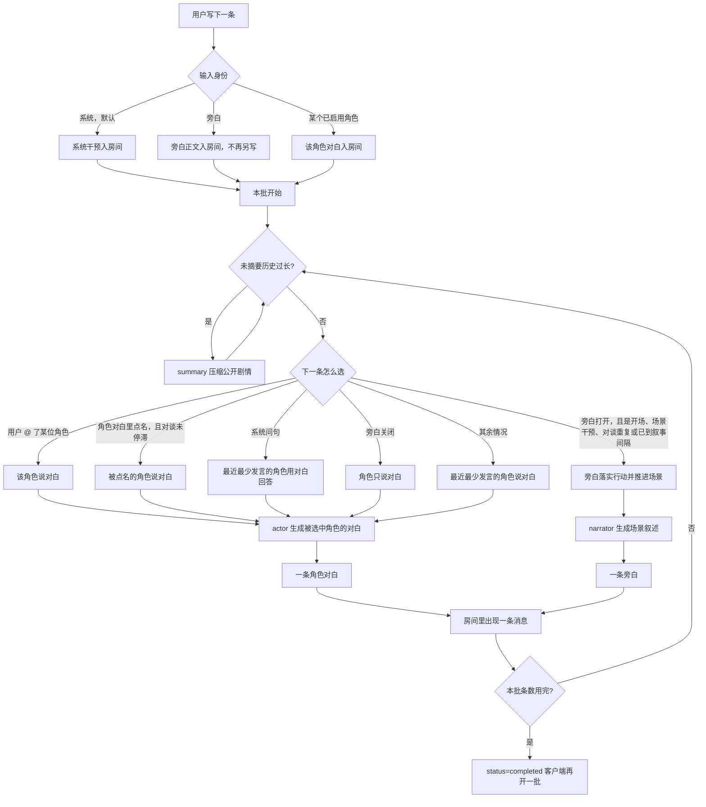
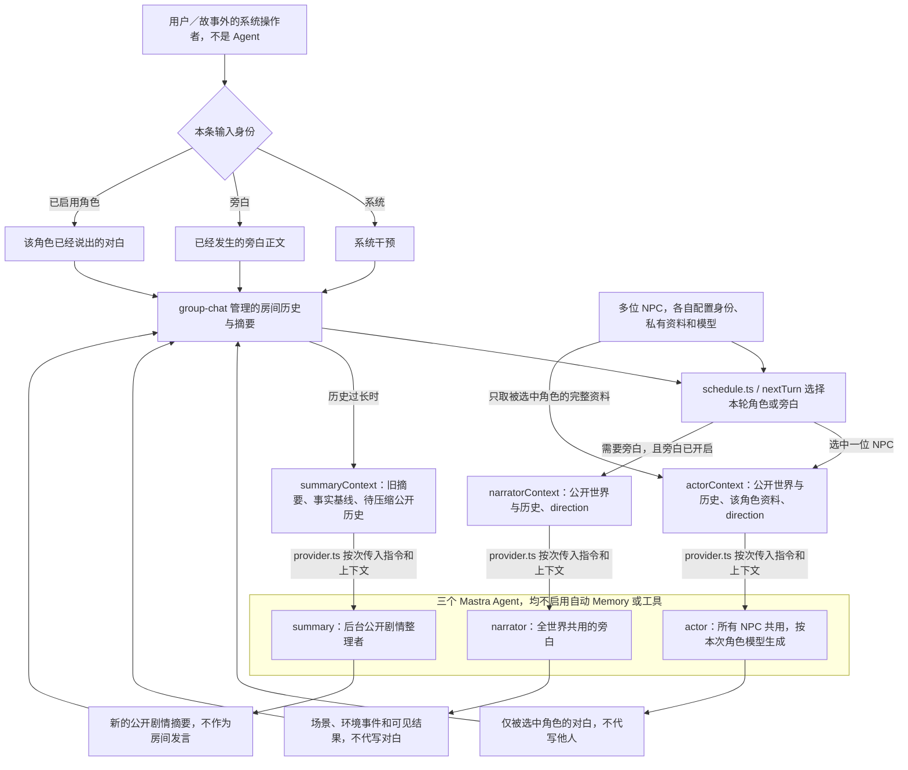
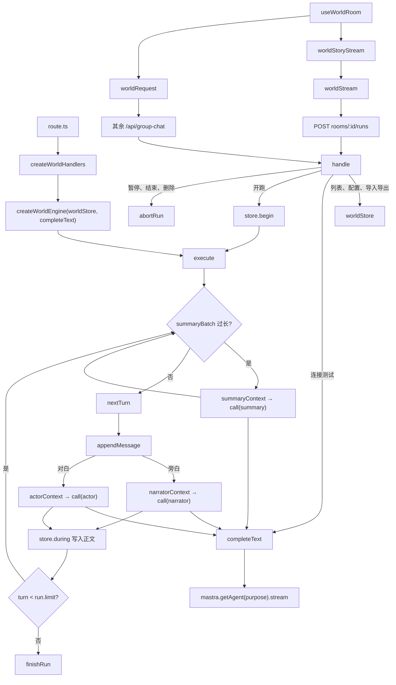

# 开放世界

开放世界首页 `/agent/worlds` 展示通用模板和「我的作品」。选择模板后，再选剧本或小说并编辑设定；模板不带类型标签，作品卡片会标明类型。创建房间时必须指定 `kind`（`script` 或 `novel`）；类型保存在服务端，详情页和配置更新接口均不提供切换。

- 剧本通过 `POST /api/group-chat/rooms/:id/runs` 调度角色对白和旁白，过程与正文存入服务端房间。
- 小说通过 `POST /api/novel` 由单个 Writer 按章生成，不启动剧本对话。小说专用设定和章节保存在当前浏览器的 IndexedDB，世界设定存入服务端。见下文「小说架构」。

两类房间都可以在创建或编辑世界时添加可选的 `WorldConfig.priorContext`。表单支持粘贴或追加导入 TXT、Markdown，最多 8000 字；导入小说背景总结时只读取总结正文。剧本将前置剧情作为公开世界设定，小说把它和当前设定、已有章节一起交给 Writer。前置剧情不会生成对话消息或增加章节数。

JSON 存档导入、导出均携带 `kind`，小说的 JSON 备份只包含世界设定，章节可在小说详情导出为 TXT 或 Markdown。没有类型的旧房间不会出现在列表中，缺少类型的旧备份无法导入。

## 小说架构

1. **页面**：房间详情根据服务端保存的 `kind` 渲染 [NovelPanel](../../app/agent/worlds/_components/novel/novel-panel.tsx)。用户编辑书名、文风和大纲，手动触发下一章或背景总结。小说房间不运行剧本的角色调度。
2. **上下文**：[useNovel](../../app/agent/worlds/_components/novel/use-novel.ts) 通过 [小说模型](../../app/agent/worlds/_components/novel/model.ts) 组装请求。写章时，Writer 一次读取完整世界设定（含人物私有资料和前置剧情）、已导入的背景、按顺序排列的已完成章节和本章要求。背景总结读取已发生的内容，省略未来大纲和下一章要求。
3. **生成**：[`/api/novel`](../../app/api/novel/route.ts) 由 [createNovelHandler](./novel.ts) 校验登录、请求来源和房间所有权，只接受未结束的小说房间。同一个 `world-writer` Agent 处理写章与总结，使用第一个启用角色的模型（全部禁用时用第一个角色的模型），通过开放世界代理流式返回文本，不启用工具或自动 Memory。
4. **保存**：流式草稿先留在页面内存。收到完整结束信号且正文非空时才追加章节；停止、报错或截断都不会进入成稿。小说专用设定和章节以 `${ownerId}:${roomId}` 为键保存在当前浏览器的 `world-novels` IndexedDB。背景总结可以导出为 Markdown，供其他房间导入；它不追加章节，也不覆盖目标房间的世界设定。

世界设定随房间存到服务端，小说专用设定和正文不会随房间跨设备同步。完整的请求契约、数据边界和后续设计见[小说模式架构](../../../docs/novel-mode.md)。

已完成章节可发起 `rewrite` 任务，支持整章重写和正文选段。Writer 读取目标内容、前后章节和可选的重写要求；选段重写还会传入本章未选中的前后正文。全书上下文过长时，保留目标章与完整的相邻章节。结果先作为草稿展示，采用后只替换对应章节或选段。

## 剧本调度

剧本房间里有三类发言：多位 NPC 只说对白，系统只有一个，旁白只有一个。

用户输入默认是系统。输入框上方可以把这一条改成旁白，或改成任意已启用的角色。写下的内容先入房间，再按下图为后续发言选人。

- 系统：这一条是干预。问句交给角色用对白回答；旁白打开时，场景类干预由旁白叙述。
- 旁白：这一条就是旁白正文，不再另写一条旁白。
- 角色：这一条就是该角色已经说出的对白。接下来由其他角色接话；句中点名或 @ 仍优先交给被点到的角色。

`narration` 默认关闭。打开后，开场、场景类系统干预、已重复的对谈，以及连续三条对白后的进展由旁白叙述。角色间的直接点名可延后一条旁白，连续四条对白后安排叙述；操作者显式点名和系统问句优先交给角色。计数跨批次累计，每条旁白后恢复角色对白。

角色根据背景故事、自身身份、性格、经历、目标和当前对话自主判断，以自己的口吻发言。通用提示词只限定本人视角、信息边界和对白形式，不规定每轮必须给出新信息、作出决定、追问或推进剧情。普通轮次的 direction 仅为“轮到你发言”；世界设定和角色资料决定具体内容。旁白用简短一段承接场景与角色言行，角色的决定和对白由各自表达；摘要保留重要事实、关系与未决事项。

剧本调度只使用 `actor`、`narrator`、`summary` 三个 Mastra Agent。多位 NPC 共用同一个 `actor` 实例，每轮由 `nextTurn` 选人，再将该角色作为 `yourCharacter` 传入。角色身份、私有资料和模型按本次调用提供，不为每个 NPC 单独创建 Agent，也不由 Agent 决定谁接话。

操作者直接写下的角色对白或旁白先作为已发生的剧情入房间，不调用 Agent 重写；之后才安排后续发言。`context.ts` 负责私有信息隔离：`actor` 只能看到本角色的私有资料和公开信息，`narrator`、`summary` 只接收公开信息。Agent 本身不保存角色历史，房间历史与摘要由 group-chat 存档维护。

`actor` 和 `narrator` 每次生成依次发送 system 指令、固定初始化资料、按发生顺序排列的未摘要公开历史、本轮状态与任务。当前角色已完成的对白（或当前旁白已完成的叙述）以 `assistant` 原文消息传入，其他发言及干预以独立的 `user.publicEvent` 消息传入，保留发言者、消息类型、seq 和提及信息；失败、未完成和已摘要的消息不进入历史。`actor` 的初始化资料包含公开世界设定和本角色完整资料，`narrator` 仅包含公开世界设定。摘要、最近干预和 direction 放在最后一条，让固定资料和持续追加的历史保持稳定前缀。`summary` 仍使用三条资料消息：system 指令、固定事实基线、旧摘要与待压缩公开历史。

Magpie 的“上下文窗口”按本次请求中的 `user` 消息划分轮次，而非累计接口调用数。此前将全部历史塞进一条 JSON 时，即使同一会话已请求多次，也只显示初始化和动态资料两轮。拆分后会展示多轮消息，但轮数仍不等于房间发言条数或请求次数；每个角色有自己的会话视角，历史压缩后展示的轮数也会减少。

`session.ts` 按所有者、房间、Agent 用途、NPC ID（仅 actor）、模型和配置计算稳定的哈希标识。`engine.ts` 随调用传入，`provider.ts` 通过本次 RequestContext 交给世界 Agent，最终以 `X-Magpie-Session` 请求头发给 Magpie。连续批次、暂停后继续、重试和摘要更新沿用标识；配置或模型变化、另建或导入房间时切换标识。哈希请求头不包含明文角色秘密，不使用全局可变的角色或会话配置。

本机 Magpie Cursor 插件依据会话标识和首条 user 消息生成 `conversation_id`，因此两者都需要稳定。这使同一角色的请求可以复用上游会话标识并争取命中提示词缓存，不代表代理会保存全部剧情供下一次只传增量。每次仍发送完整的有效上下文（固定设定、已有摘要和本次所需公开历史），每条回复仍有一次接口调用；实际缓存命中及收益由代理和模型决定。

进程启动时 `route.ts` 调用一次 `createWorldHandlers`。里面的 `createWorldEngine(worldStore, completeText)` 只执行这一次，得到 `execute`。之后每一批发言都调用这个 `execute`。测试要换假的 `complete`，所以每个用例会再调用一次 `createWorldEngine`。

