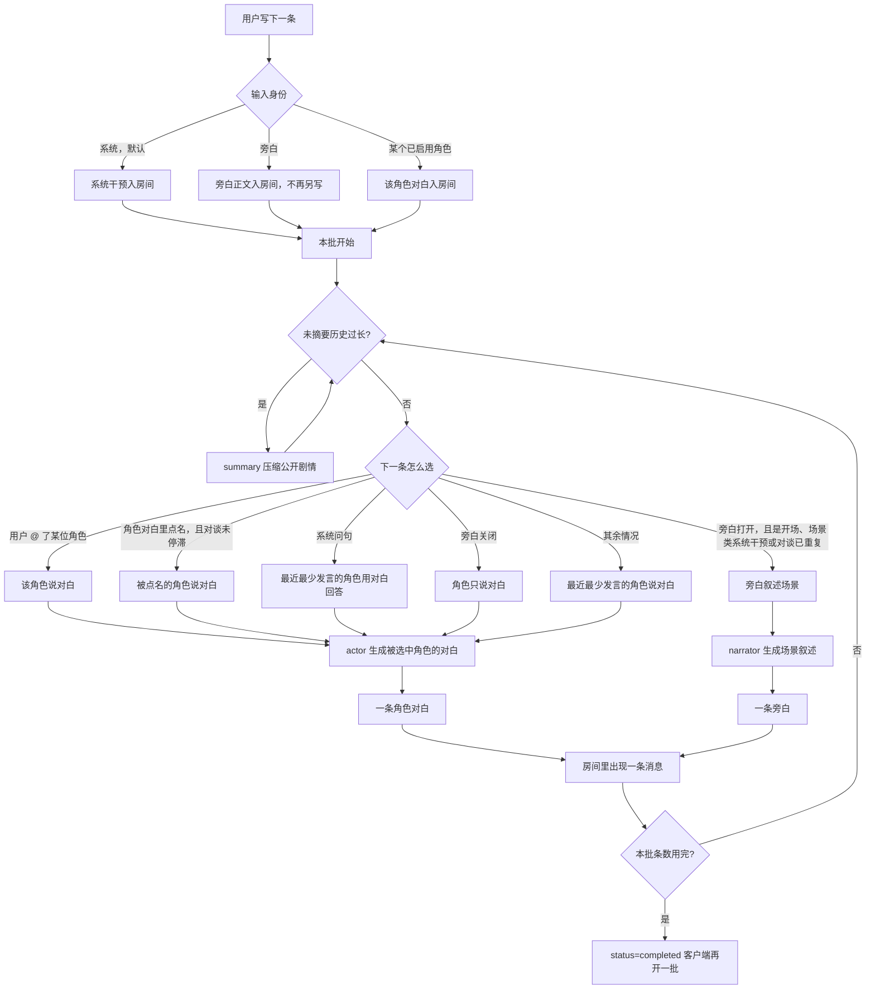
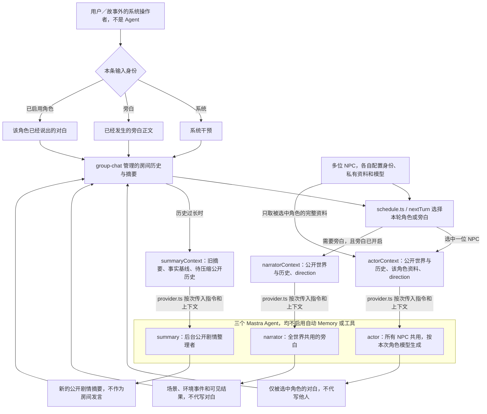
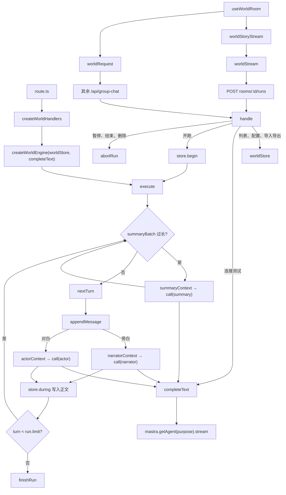

房间里有三类发言：多位 NPC 只说对白，系统只有一个，旁白只有一个。

用户输入默认是系统。输入框上方可以把这一条改成旁白，或改成任意已启用的角色。写下的内容先入房间，再按下图为后续发言选人。

- 系统：这一条是干预。问句交给角色用对白回答；旁白打开时，场景类干预由旁白叙述。
- 旁白：这一条就是旁白正文，不再另写一条旁白。
- 角色：这一条就是该角色已经说出的对白。接下来由其他角色接话；句中点名或 @ 仍优先交给被点到的角色。

`narration` 默认关闭。打开后，开场、场景类系统干预和已经重复的对谈才由旁白叙述。问句干预和点名始终交给对应角色。

房间身份与 Mastra Agent 的对应关系如下。只注册 `actor`、`narrator`、`summary` 三个 Agent；多位 NPC 共用同一个 `actor` 实例，每轮由 `nextTurn` 选人，再将该角色作为 `yourCharacter` 传入。角色身份、私有资料和模型按本次调用提供，不为每个 NPC 单独创建 Agent，也不由 Agent 决定谁接话。

操作者直接写下的角色对白或旁白先作为已发生的剧情入房间，不调用 Agent 重写；之后才安排后续发言。`context.ts` 负责私有信息隔离：`actor` 只能看到本角色的私有资料和公开信息，`narrator`、`summary` 只接收公开信息。Agent 本身不保存角色历史，房间历史与摘要由 group-chat 存档维护。

每次生成都发送三条上下文消息：system 指令、固定初始化资料、本轮状态与任务。`actor` 的初始化资料包含公开世界设定和本角色完整资料，`narrator` 仅包含公开世界设定，`summary` 仅包含事实基线。摘要、最近干预、未摘要历史和 direction 等变化内容放在最后一条，避免每次改变首条 user 消息，也不重复发送固定资料。

`session.ts` 按所有者、房间、Agent 用途、NPC ID（仅 actor）、模型和配置计算稳定的哈希标识。`engine.ts` 随调用传入，`provider.ts` 通过本次 RequestContext 交给世界 Agent，最终以 `X-Magpie-Session` 请求头发给 Magpie。连续批次、暂停后继续、重试和摘要更新沿用标识；配置或模型变化、另建或导入房间时切换标识。哈希请求头不包含明文角色秘密，不使用全局可变的角色或会话配置。

本机 Magpie Cursor 插件依据会话标识和首条 user 消息生成 `conversation_id`，因此两者都需要稳定。这使同一角色的请求可以复用上游会话标识并争取命中提示词缓存，不代表代理会保存全部剧情供下一次只传增量。每次仍发送完整的有效上下文（固定设定、已有摘要和本次所需公开历史），每条回复仍有一次接口调用；实际缓存命中及收益由代理和模型决定。

进程启动时 `route.ts` 调用一次 `createWorldHandlers`。里面的 `createWorldEngine(worldStore, completeText)` 只执行这一次，得到 `execute`。之后每一批发言都调用这个 `execute`。测试要换假的 `complete`，所以每个用例会再调用一次 `createWorldEngine`。

